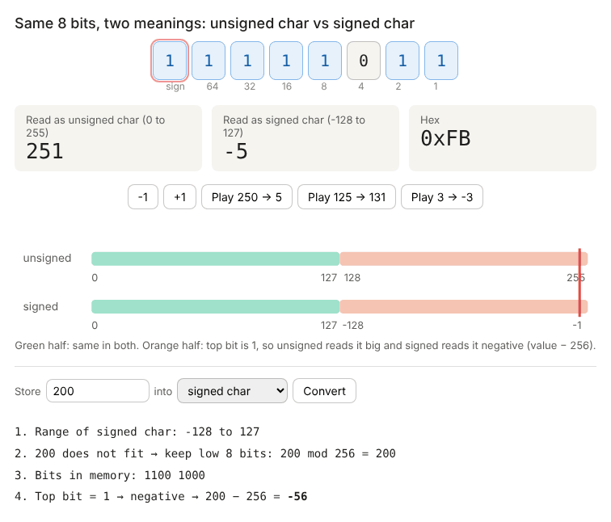

# 01 · Data Types and Operators

**Quiz:** [quiz.md](quiz.md) · **Answers and solutions:** [answers.md](answers.md)

---

## Theory

### 1. Sizes you must know

| Type | Bits | Unsigned range | Signed range |
|---|---|---|---|
| `char` | 8 | 0 … 255 | −128 … 127 |
| `short` | 16 | 0 … 65,535 | −32,768 … 32,767 |
| `int` | 32 | 0 … 4,294,967,295 | −2,147,483,648 … 2,147,483,647 |

Formula for N bits: unsigned is **0 … 2ᴺ−1**, signed is **−2ᴺ⁻¹ … 2ᴺ⁻¹−1**.

| Data model | `int` | `long` | pointer | Where |
|---|---|---|---|---|
| ILP32 | 4 | 4 | 4 | 32-bit ARM, 32-bit Linux |
| LP64 | 4 | **8** | 8 | 64-bit Linux / macOS |
| LLP64 | 4 | **4** | 8 | 64-bit Windows |

`sizeof(char)` is **always 1**. In firmware, use `<stdint.h>` types (`uint8_t`, `uint32_t`) so the size never changes.

### 2. Signed vs unsigned: the same bits, read two ways

Memory stores only bits. `signed` and `unsigned` are two ways of **reading** them.



> Interactive version (buttons and a "store a value" converter): download [`assets/signed_unsigned_8bit.html`](assets/signed_unsigned_8bit.html) and open it in a browser.

```
 8-bit:      0 ... 127 | 128 ... 255     ← read as unsigned
 signed:     0 ... 127 |-128 ...  -1     ← same bits read as signed
                        ↑ top bit = 1 here
```

**Storing a value that does not fit:**
```
 value ──► does it fit the type's range?
             │ yes → stored as is
             │ no  → keep only the low N bits  (value mod 2ᴺ)
                         │
                         ▼
             read the bits:  unsigned → as is
                             signed   → top bit 1?  value − 2ᴺ
```
| Code | Bits | Result |
|---|---|---|
| `unsigned char c = -1;` | 1111 1111 | 255 |
| `unsigned char c = 300;` | 300 − 256 | 44 |
| `signed char c = 200;` | 1100 1000 | 200 − 256 = **−56** |
| `short s = 40000;` | top bit 1 | 40000 − 65536 = **−25536** |
| `unsigned short s = -1;` | 16 ones | **65535** (16 bits, not 32) |

Two tricks:
- **−1 is always "all 1s"**, which is the maximum value of that unsigned type.
- An unsigned value is **never** negative.

### 3. Plain `char` is implementation-defined
`char c = 255; printf("%d", c);` prints −1 with x86 GCC (signed char) and 255 with ARM GCC (unsigned char). Always write `signed char`, `unsigned char` or `uint8_t`.

### 4. Implicit conversions: what the compiler does
```
 Step 1 (integer promotion):  char / short ──► int      (before any + - * < > etc.)
 Step 2 (balancing):          int  vs unsigned int ──► BOTH become unsigned
                              int  vs long         ──► BOTH become long
                              any  vs double       ──► BOTH become double
 Ladder: int → unsigned → long → unsigned long → float → double
```
**Example:** `-1 < 1u` → −1 becomes unsigned → 0xFFFFFFFF → `4294967295 < 1` → **false**.

| Trap | Why |
|---|---|
| `sizeof(int) > -1` is **false** | `sizeof` returns `size_t` (unsigned), so −1 becomes SIZE_MAX |
| `strlen("ab") - strlen("abc") > 0` is **true** | `size_t` maths wraps to a huge number |
| `for (unsigned i = 5; i >= 0; i--)` is an **infinite loop** | unsigned is always ≥ 0 |
| `unsigned char a=200, b=100; a + b` is 300 | promoted to int first, so no overflow |

### 5. Undefined behaviour (UB): compiles fine, result unpredictable

**UB detector:**
```
 STEP 1: find a variable that has ++ / -- / =
 STEP 2: does the SAME variable appear anywhere else in the statement?
 STEP 3: is there a && || ?: or comma-OPERATOR between them?
         appears again + no separator  →  UB
```
| Code | Verdict |
|---|---|
| `i = i++;` `x++ + x++` `a[i] = i++` `(x = 3) + x` | **UB** |
| `printf("%d %d", x, x++)` | **UB** (argument commas are NOT sequence points) |
| `(a++, a++, a)` `a++ && a` `x++ ? 10 : 20` | defined (comma operator, `&&` and `?:` are sequence points) |
| `INT_MAX + 1` | **UB** (signed overflow) |
| `UINT_MAX + 1u` | defined → 0 (unsigned wraps) |
| `1 << 31` (signed int), `x << 32` | **UB** (use `1u << 31`) |
| `printf("%d", 3.5)` / `printf("%f", 3)` | **UB** (format/type mismatch) |

| Compile error vs UB vs legal | Examples |
|---|---|
| Compile error | missing `;`, `const` assignment, `int x = 08;`, bad name `2x` |
| UB (compiles!) | the table above |
| Legal | `if (a = 0)` (assigns, warning only), `int x = 5;;`, `if (x == 10);` (empty body) |

`-1 >> 1` is **implementation-defined**, not UB. GCC copies the sign bit, so the result is −1.

### 6. `sizeof` is computed at compile time
`sizeof(i++)` leaves `i` unchanged: the operand is never executed. `sizeof('A')` is 4 in C (a char constant is an `int`), but 1 in C++. `sizeof(3.14)` is 8 (a double), and `sizeof(3.14f)` is 4.

### 7. Precedence (high → low)
```
 ()  ++ --  !  ~  (unary)
 * / %
 + -
 << >>                 ← arithmetic BEFORE shift:   x << 1 + 1  =  x << 2
 < > <= >=
 == !=                 ← comparison BEFORE bitwise: x & 2 == 2  =  x & (2 == 2)
 &   ^   |
 &&                    ← && BEFORE ||
 ||
 ?:                    ← c ? 10 : 20 + 5   =   c ? 10 : (20 + 5)
 = += -= *= ...        ← x *= 2 + 3        =   x = x * (2 + 3)
 ,                     ← x = 5, 10;        =   (x = 5), 10;
```
- `10 > 5 > 2` → `(1) > 2` → 0.
- `&&` and `||` short-circuit: the right side may never run.
- The comma operator returns its **last** value.

### 8. Literals and number systems
```
 010   = octal 8      (a leading 0 means octal; 08 / 09 are compile errors)
 0x10  = hex 16
 'a' - 'A' = 32       '\0' = 0      '0' = 48
 ^ is XOR, not power
```

### 9. Division, modulo and floats
- Integer division truncates **toward zero**: `-7 / 2 = -3`. `%` takes the sign of the dividend: `-7 % 2 = -1`, `7 % -3 = 1`.
- A cast truncates: `(int)3.99 = 3`, `(int)-3.99 = -3`.
- A float equals a double **only** when the value is exact in binary (a sum of powers of 2):
  - `0.5`, `0.25`, `0.75` are exact, so `0.5 == 0.5f` is true.
  - `0.1`, `0.2`, `0.3` are not exact, so `0.1 + 0.2 == 0.3` is false. Compare with `fabs(a - b) < eps`.

### 10. The 5-step method for any "what is the output?" question
```
┌─────────────────────────────────────────────┐
│ 1. UB CHECK  → var modified twice? signed    │
│               overflow? bad shift/format?    │
├─────────────────────────────────────────────┤
│ 2. BRACKETS  → add () by precedence          │
├─────────────────────────────────────────────┤
│ 3. TYPES     → char/short → int              │
│               signed + unsigned → unsigned   │
├─────────────────────────────────────────────┤
│ 4. EVALUATE  → short-circuit? sizeof not run │
├─────────────────────────────────────────────┤
│ 5. STORE     → cut to destination size       │
└─────────────────────────────────────────────┘
```

### Common doubts
- **"Is UB a compile error?"** No. UB code compiles. Only the result is undefined.
- **"Why does `if (a = 0)` compile?"** Assignment is an expression whose value is the assigned value (0), so it's legal. Writing `if (0 == a)` catches the typo.
- **"Why is `a+++b` legal?"** The compiler takes the longest token first, so it reads `a++ + b`.

---

## Practice Questions
Write each one by hand first, then run it. Solutions are in [answers.md](answers.md#practice-solutions).

1. Print the size and min/max of `char`, `short`, `int`, `long` and `long long` using `<limits.h>`.
2. Swap two numbers without a temp variable, once with `+`/`-` and once with XOR. When does each one break?
3. `int safe_add(int a, int b, int *res)`: return −1 if the addition would overflow (check **before** adding).
4. Reverse the digits of an integer, including negatives and overflow (e.g. 1534236469).
5. Find out whether plain `char` is signed or unsigned on your compiler, without `<limits.h>`.

**Explain out loud:**
6. Why use `uint32_t` instead of `int` in firmware?
7. What is the difference between implementation-defined and undefined behaviour?

---

## Interview One-liner
*"Draw the bits, then let the type read them. UB needs a side effect, overflow, a bad shift or a bad format string, and it still compiles."*
