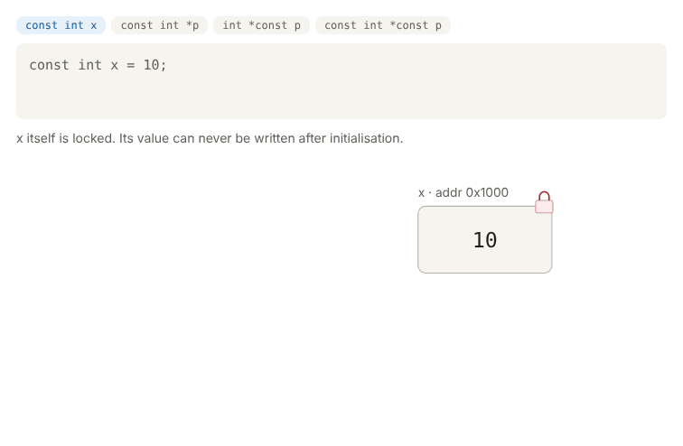

# 02 · Storage Classes, const, volatile, Memory Layout

**Quiz:** [quiz.md](quiz.md) · **Answers and solutions:** [answers.md](answers.md)

---

## Theory

### 1. Memory layout of a C program
```
 High addr ┌───────────────┐
           │    STACK  ↓   │ local vars, function args, return address
           │               │ freed automatically when the function returns
           │      ↑ HEAP   │ malloc/calloc → lives until free()
           ├───────────────┤
           │     .bss      │ globals/statics UNINITIALISED or = 0
           │               │ → zeroed at startup, takes NO space in the binary
           │     .data     │ globals/statics initialised to non-zero values
           │    .rodata    │ string literals, const globals (read-only)
           │     .text     │ code (read-only)
 Low addr  └───────────────┘
```
Before `main()` runs, the startup code (crt0) **copies `.data`** from flash to RAM and **zeroes `.bss`**. That's why a huge `int buf[100000];` global doesn't make the ELF file bigger: only its size is recorded.

### 2. Storage classes
| Keyword | Lives in | Lifetime | Visible in | Default value |
|---|---|---|---|---|
| `auto` (normal local) | stack | until the function returns | that block | **garbage** |
| `static` local | .data / .bss | whole program | that function only | 0 |
| global | .data / .bss | whole program | all files (via `extern`) | 0 |
| `static` global / function | .data / .bss | whole program | **this file only** | 0 |
| `extern` | (declaration only, no memory) | — | — | — |
| `register` | CPU register (a hint) | block | block | garbage; `&` is **not allowed** |

- A `static` local is **initialised once**, and the initialiser must be a **constant** (`static int x = f();` is a compile error in C).
- A `static` global or function has **internal linkage**: another file's `extern` gets an "undefined reference" at link time.

### 3. `char *p = "hi"` vs `char a[] = "hi"`
```
 char *p = "hello";   p (stack) ──► "hello" in .rodata   → p[0] = 'H' is UB (often a segfault)
 char a[] = "hello";  a = own copy on the stack          → a[0] = 'H' is fine
```
Returning `&local` from a function gives a **dangling pointer** (UB). Fix it with `static`, `malloc`, or a caller-provided buffer.

### 4. `const` and pointers



> Interactive version: open [`assets/const_pointer.html`](assets/const_pointer.html) in a browser.

**Rule: split at the `*`.** `const` on the LEFT of `*` locks the **data**. `const` on the RIGHT of `*` locks the **pointer**.
```
      const int  *  p          int  *  const p
      └──LEFT──┘    │          └─┘     └RIGHT┘
   → DATA locked               → POINTER locked
```
| Declaration | `*p = 20` | `p = &b` | Typical use |
|---|---|---|---|
| `const int *p` (= `int const *p`) | ❌ | ✅ | `strlen(const char *s)`: "I won't change your data" |
| `int *const p` | ✅ | ❌ | a fixed MMIO register address |
| `const int *const p` | ❌ | ❌ | a fixed read-only table |

Read declarations **right to left**: `int *const p` means "p is a const pointer to int".

**How `const` works:** it's a **compile-time** check. A write produces `error: assignment of read-only location`. The memory is still ordinary RAM, so casting `const` away and writing (`*(int *)&x = 20`) is **UB**: the compiler may already have folded the value into the code.

### 5. `volatile`
```
 Without volatile:  the compiler reads flag once → keeps it in a register → while(!flag); never ends
 With volatile:     every read/write really goes to memory
```
Use it for **MMIO registers**, **variables shared with an ISR**, and **memory shared between cores or DMA**.

`volatile` does **not** make an access atomic. `counter++` is load, add, store, so an ISR can run in between and an update is lost. Disable interrupts or use atomics.

`const volatile` means **code can't write it, hardware can change it**. Example: a read-only status register.
```c
#define STATUS (*(const volatile uint32_t *)0x40000004u)
while (!(STATUS & 1u)) { }   /* re-read every loop */
```

### Common doubts
- **"Is `const int *p` the same as `int const *p`?"** Yes. In both, the `const` is to the left of `*`.
- **"If `const` is only a compiler check, can the value still change?"** Yes, through hardware (if it's also `volatile`) or through UB casts. `const` is a promise **your code** makes.

---

## Practice Questions
Solutions are in [answers.md](answers.md#practice-solutions).

1. Write a function that returns how many times it has been called, using a `static` local. Why is a global worse?
2. Split a program into `a.c` and `b.c`: share one global with `extern`, and hide one helper with `static`. What happens at link time if `b.c` calls the hidden helper?
3. Declare a **volatile** pointer to a 32-bit register at `0x40001000`. Write `set_bit(n)` and `wait_until_ready()`, which polls bit 0 of the status register.
4. Print the addresses of a local, a static local, a global, a `malloc` block and a string literal. Sort them. Do they match the memory map?
5. Fix: `char *get_name(void) { char n[] = "sai"; return n; }`. Give two fixes.

**Explain out loud:**
6. Can a variable be both `const` and `volatile`? Give a real example.
7. What is the difference between `.data` and `.bss`, and who initialises them before `main()`?

---

## Interview One-liner
*"`const` left of the star locks the data, right of the star locks the pointer. `volatile` means always re-read it, and it is not atomic."*
