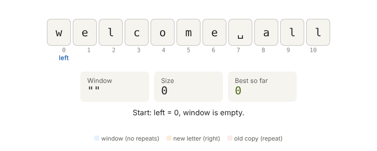

# 02 · Substrings and the Sliding Window

**Answers and solutions:** [answers.md](answers.md)

---

## Theory

### 1. Substring vs subsequence
A **substring** is a **continuous** piece of a string: characters next to each other, in order, with no gaps.
```
 s = "abc"
 index:   0   1   2
         ┌───┬───┬───┐
         │ a │ b │ c │
         └───┴───┴───┘
 All substrings:  "a" "b" "c" | "ab" "bc" | "abc"   → n(n+1)/2 = 6   (+ "" if counted)
```
| Term | Continuous? | Order kept? | `"abc"` example |
|---|---|---|---|
| **Substring** | ✅ | ✅ | `"bc"` ✓, `"ac"` ✗ |
| **Subsequence** | ❌ gaps allowed | ✅ | `"ac"` ✓, `"ca"` ✗ |
| Subarray | the same as a substring, for arrays | | |

### 2. Problem: longest substring without repeating characters
**Find the longest continuous piece in which every character is different, and return its length.**
- It must be continuous, with no repeats inside.
- The space counts as a character, and `'A'` ≠ `'a'`.
- Return the **length**.

| Input | Longest piece | Output |
|---|---|---|
| `"abcabcbb"` | `abc` | 3 |
| `"bbbbb"` | `b` | 1 |
| `"pwwkew"` | `wke` (`pwke` isn't continuous) | 3 |
| `"welcome all"` | `lcome a` / `come al` | 7 |
| `"abba"` | `ab` / `ba` | 2 |
| `""` | — | 0 |

**Worked example, `"welcome all"`: start from each letter and stop at the first repeat**
```
 index:  0   1   2   3   4   5   6   7   8   9   10
         w   e   l   c   o   m   e   ␣   a   l   l
```
| Start | Walk until a repeat | Piece | Length |
|---|---|---|---|
| w (0) | stops at the 2nd `e` | `welcom` | 6 |
| e (1) | stops at the 2nd `e` | `elcom` | 5 |
| **l (2)** | stops at the 2nd `l` | **`lcome a`** | **7** |
| **c (3)** | stops at the 3rd `l` | **`come al`** | **7** |
| … | all shorter | | |

### 3. Method 1: simple, O(n²) (write this first in an interview)
```
 for each START:
     clear seen[256]
     walk forward: if seen[c] → stop; else seen[c] = 1, count++
     best = max(best, count)
```
**How `seen[c]` works:** a `char` is a small integer (`'e'` = 101), so `seen[c]` is a **direct jump** to one slot (`seen[101]`). There's no loop over `seen`. The character **is** the index, which makes the check O(1).
```
 seen[]:  [0] ... [99] ... [101] ... [108] ... [119] ... [255]
                   'c'      'e'       'l'       'w'
```
Use `unsigned char c` for the index. Plain `char` is signed on x86, so a byte ≥ 128 would give a **negative** index (UB).

### 4. Method 2: sliding window, O(n)



> Interactive version: open [`assets/sliding_window.html`](assets/sliding_window.html) in a browser. You can pass another string, e.g. `sliding_window.html?s=abba`.

Keep **one** window `[left … right]` that has no repeats. Don't restart.
1. `right` moves forward by 1 every step.
2. If the new character is **already inside** the window, `left` jumps to just after its old position.
3. Window size = `right − left + 1`; keep the biggest.

| | Method 1 | Sliding window |
|---|---|---|
| Table | `seen[c]` = 0/1, reset for each start | `last[c]` = last index of c, **−1 = never seen**, never reset |
| "Inside the window?" | `seen[c]` | `last[c] >= left` |
| Time | O(n²) | **O(n)**: `right` visits each index once, `left` only moves forward |

**Why initialise `last[]` to −1 and not 0?** 0 is a real index (position 0). With `{0}`, the very first character would look "seen at index 0" and move `left` wrongly. For `"ab"` you'd get 1 instead of 2.

**Why `last[c] >= left`?**
```
 "abba":  at the last 'a', last['a'] = 0 but left = 2
          0 < left → that old 'a' already left the window → NOT a repeat
          without the check, left would jump BACKWARD → wrong answer
```
**Why `>=` and not `>`?** `left` itself is inside the window. For `"aa"`: `last['a'] = 0`, `left = 0`, so `0 >= 0` is a repeat ✓, while `0 > 0` would miss it.

### 5. Other sliding-window problems
- Maximum sum of k consecutive elements
- Smallest subarray with sum ≥ target
- Longest substring with at most k distinct characters

---

## Practice Questions
Solutions are in [answers.md](answers.md#practice-solutions).

| # | Problem | Input → Output |
|---|---|---|
| 1 | Print all substrings | `"abc"` → `a ab abc b bc c` |
| 2 | Longest substring without repeats: Method 1 (O(n²)) | `"welcome all"` → `7` |
| 3 | The same with a sliding window (O(n)). Test `"abba"`, `"bbbbb"`, `""` | `2`, `1`, `0` |
| 4 | Is t a substring of s? Return the index or −1 (no `strstr`) | `"hello","ell"` → `1` |
| 5 | Maximum sum of k consecutive elements | `{2,1,5,1,3,2}, k=3` → `9` |
| 6 | Smallest subarray length with sum ≥ target | `{2,3,1,2,4,3}, 7` → `2` |
| 7 | Longest substring with at most k distinct characters | `"eceba", k=2` → `3` |

---

## Interview One-liner
*"Keep a window with no repeats. right always grows it, and on a repeat left jumps past the old copy. Each index is visited once, so it's O(n) time and O(1) space."*
