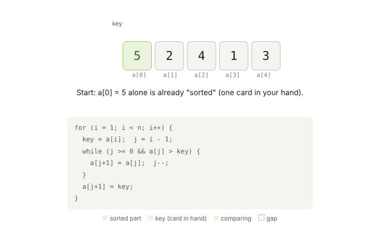

# 03 · Searching and Sorting

**Quiz:** [quiz.md](quiz.md) · **Answers and solutions:** [answers.md](answers.md)

---

## Theory: Searching

### Linear search: O(n), works on any array
Check each element one by one until you find it.

### Binary search: O(log n), the array MUST be sorted
```
 Find 7 in  {1, 3, 5, 7, 9, 11}
 idx:        0  1  2  3  4  5

 step 1: low=0 high=5 → mid=2 → a[2]=5 < 7 → go RIGHT (low = mid+1 = 3)
 step 2: low=3 high=5 → mid=4 → a[4]=9 > 7 → go LEFT  (high = mid-1 = 3)
 step 3: low=3 high=3 → mid=3 → a[3]=7 ✓  FOUND at index 3
 Each step halves the range → 1000 elements need only ~10 steps
```
```c
int binary_search(const int *a, int n, int key) {
    int low = 0, high = n - 1;
    while (low <= high) {                    /* <= : a 1-element range is still valid */
        int mid = low + (high - low) / 2;    /* (low+high) can overflow */
        if (a[mid] == key) return mid;
        if (a[mid] <  key) low  = mid + 1;   /* +1 / -1, or you get an infinite loop */
        else               high = mid - 1;
    }
    return -1;
}
```
| Trap | Why it's wrong |
|---|---|
| `mid = (low + high) / 2` | `low + high` can overflow an int (UB) |
| `low = mid` instead of `mid + 1` | the range stops shrinking → **infinite loop** |
| `while (low < high)` | misses the last single element |

---

## Theory: Sorting

### Bubble sort: swap neighbours; the biggest "bubbles" to the end
```
 {5 1 4 2 8}  pass 1: 5↔1 → 1 5 4 2 8 → 5↔4 → 1 4 5 2 8 → 5↔2 → 1 4 2 5 8 → 5<8 ok
              after pass 1: {1 4 2 5 8}   ← 8 is in its final place
```
```c
void bubble(int *a, int n) {
    for (int i = 0; i < n - 1; i++) {
        int swapped = 0;
        for (int j = 0; j < n - 1 - i; j++)       /* the last i elements are already sorted */
            if (a[j] > a[j + 1]) { int t = a[j]; a[j] = a[j + 1]; a[j + 1] = t; swapped = 1; }
        if (!swapped) break;                      /* already sorted → best case O(n) */
    }
}
```

### Selection sort: find the min and put it at the front
```
 {64 25 12 22 11} → min 11 ↔ 64 → {11 25 12 22 64} → min 12 ↔ 25 → {11 12 25 22 64} …
```
```c
void selection(int *a, int n) {
    for (int i = 0; i < n - 1; i++) {
        int m = i;
        for (int j = i + 1; j < n; j++) if (a[j] < a[m]) m = j;
        int t = a[i]; a[i] = a[m]; a[m] = t;      /* at most n-1 swaps: good when writes are expensive */
    }
}
```

### Insertion sort: like sorting playing cards in your hand



> Interactive version: open [`assets/insertion_sort.html`](assets/insertion_sort.html) in a browser.

**Easiest version: keep swapping the new number LEFT while its left neighbour is bigger.**
```
 {4, 3, 1}
 take 3:  4 > 3 → swap → {3, 4, 1}                  reached the start → stop
 take 1:  4 > 1 → swap → {3, 1, 4}
          3 > 1 → swap → {1, 3, 4}                  reached the start → stop
```
```c
void insertion_swap(int *a, int n) {
    for (int i = 1; i < n; i++) {
        int j = i;                                 /* j = where the new number is now */
        while (j > 0 && a[j - 1] > a[j]) {         /* left neighbour bigger? */
            int t = a[j - 1]; a[j - 1] = a[j]; a[j] = t;
            j--;                                   /* the new number moved one step left */
        }
    }
}
```
**Faster version (the "key" version): hold the number in your hand, shift bigger ones right, then put it down once.**
```c
void insertion_key(int *a, int n) {
    for (int i = 1; i < n; i++) {
        int key = a[i];                  /* 1. PICK UP the card (save it: a[i] is about to be overwritten) */
        int j = i - 1;                   /*    j = the card we compare with (left neighbour) */
        while (j >= 0 && a[j] > key) {
            a[j + 1] = a[j];             /* 2. SHIFT the bigger card right, into the gap */
            j--;                         /*    the gap moves one step left */
        }
        a[j + 1] = key;                  /* 3. DROP the key into the last gap */
    }
}
```
Trace of one pass (`i = 2`, `a = {3, 4, 1}`, `key = 1`, `j = 1`):

| Step | Line | j | Real meaning | Array after |
|---|---|---|---|---|
| start | `key = a[2]` | 1 | save 1 in hand | `{3, 4, 1}` |
| 1 | `a[j+1] = a[j]` | 1 | `a[2] = a[1]` (copy 4) | `{3, 4, 4}` |
| | `j--` | 0 | | |
| 2 | `a[j+1] = a[j]` | 0 | `a[1] = a[0]` (copy 3) | `{3, 3, 4}` |
| | `j--` | −1 | loop stops | |
| end | `a[j+1] = key` | −1 | `a[0] = 1` | `{1, 3, 4}` ✓ |

```
 j     = the card being COMPARED
 j + 1 = the GAP (always the slot right after j)
```
`a[j+1]` is written several times, but each time to a **different box**, because `j` changes in between. Nothing is lost: a copy doesn't erase anything, so the old box becomes a spare duplicate (the gap). The only value that could be lost is the original `a[i]`, and that's why it's saved in `key` first.

| | Swap version | Key version |
|---|---|---|
| `j` points at | the new number | its left neighbour |
| starts at | `j = i` | `j = i - 1` |
| each step | swap (3 writes) | shift (1 write) |
| at the end | nothing | `a[j+1] = key` |

### Quick sort: pick a pivot, put smaller left and bigger right, recurse
```
 {7 2 9 4 3}  pivot = 3 → {2 | 3 | 7 9 4} → recurse on the left and right parts
```
```c
void quick(int *a, int lo, int hi) {
    if (lo >= hi) return;
    int p = a[hi], i = lo;                         /* Lomuto: last element is the pivot */
    for (int j = lo; j < hi; j++)
        if (a[j] < p) { int t = a[i]; a[i] = a[j]; a[j] = t; i++; }
    int t = a[i]; a[i] = a[hi]; a[hi] = t;         /* pivot goes to its final place i */
    quick(a, lo, i - 1);
    quick(a, i + 1, hi);
}
```

### Merge sort: split in half, sort each half, merge
```
 {38 27 43 3} → {38 27} {43 3} → {27 38} {3 43} → merge → {3 27 38 43}
```
```c
void merge_sort(int *a, int *tmp, int lo, int hi) {
    if (lo >= hi) return;
    int mid = lo + (hi - lo) / 2;
    merge_sort(a, tmp, lo, mid);
    merge_sort(a, tmp, mid + 1, hi);
    int i = lo, j = mid + 1, k = lo;
    while (i <= mid && j <= hi) tmp[k++] = (a[i] <= a[j]) ? a[i++] : a[j++];
    while (i <= mid) tmp[k++] = a[i++];
    while (j <= hi)  tmp[k++] = a[j++];
    for (k = lo; k <= hi; k++) a[k] = tmp[k];
}
```

### Memorise this table
| Algorithm | Best | Average | Worst | Extra space | Stable? | Use when |
|---|---|---|---|---|---|---|
| Bubble | O(n)\* | O(n²) | O(n²) | O(1) | ✅ | tiny arrays, teaching |
| Selection | O(n²) | O(n²) | O(n²) | O(1) | ❌ | writes are expensive (flash): fewest swaps |
| Insertion | O(n) | O(n²) | O(n²) | O(1) | ✅ | **small or nearly sorted data** (good for embedded) |
| Quick | O(n log n) | O(n log n) | **O(n²)** | O(log n) stack | ❌ | general purpose. Sorted input with a last-element pivot is the worst case, so use a random or median-of-3 pivot |
| Merge | O(n log n) | O(n log n) | O(n log n) | **O(n)** | ✅ | guaranteed speed; **linked lists** (no extra array needed) |
| Binary search | O(1) | O(log n) | O(log n) | O(1) | — | sorted data |

\*with the `swapped` flag. **Stable** means equal elements keep their original order.

---

## Practice Questions
Solutions are in [answers.md](answers.md#practice-solutions).

**Searching**
| # | Problem | Input → Output |
|---|---|---|
| 1 | Binary search: iterative and recursive | `{1,3,5,7,9,11}`, 7 → `3` |
| 2 | First and last position of a key (with duplicates) | `{1,2,2,2,3}`, 2 → `1 3` |
| 3 | Integer square root with binary search | `17` → `4` |
| 4 | Search in a rotated sorted array | `{4,5,6,7,0,1,2}`, 0 → `4` |

**Sorting**
| # | Problem | Input → Output |
|---|---|---|
| 5 | Bubble sort with the `swapped` flag, counting passes | `{1,2,3,5,4}` → sorted in 2 passes |
| 6 | Selection sort, counting swaps | `{64,25,12,22,11}` → `{11,12,22,25,64}` |
| 7 | Insertion sort: the swap version, then the key version | `{5,2,4,1,3}` → `{1,2,3,4,5}` |
| 8 | Generic sort with a comparator function pointer: ascending and descending | `{3,1,2}` → `{1,2,3}` / `{3,2,1}` |
| 9 | Sort an array of `struct student` by marks | 3 students → by marks |
| 10 | Sort 0s, 1s and 2s in one pass (Dutch flag) | `{2,0,1,2,0}` → `{0,0,1,2,2}` |
| 11 | Merge two sorted arrays into a third | `{1,4,7},{2,3,9}` → `{1,2,3,4,7,9}` |
| 12 | Quick sort (Lomuto) | `{7,2,9,4,3}` → `{2,3,4,7,9}` |
| 13 | Merge sort on an array | `{38,27,43,3}` → `{3,27,38,43}` |
| 14 | Sort a singly linked list (merge sort on nodes) | `4→1→3→2` → `1→2→3→4` |

**Explain out loud:**
15. When would you choose insertion sort over quick sort?
16. Why does quick sort hit its worst case on sorted input, and how do you avoid it?

---

## Interview One-liner
*"Binary search needs sorted data: mid = low + (high - low) / 2 and mid ± 1. For small or nearly sorted data, insertion sort. For a guaranteed n log n, merge sort. For a fast in-place average, quick sort."*
