# 01 · Camera ISP: from light to NV12

This topic follows one picture all the way through a camera: light hits the sensor, the sensor sends raw numbers, the **ISP (Image Signal Processor)** turns them into a viewable image, and the result is stored in memory as NV12. No heavy maths: each step is explained by what it does, why it is needed, and what the picture looks like without it.

---

## Theory

### 1. The big picture

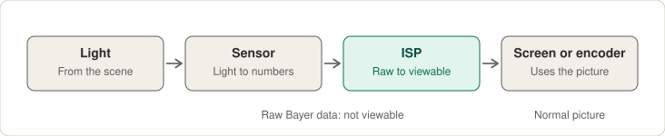

| Block | Job |
|---|---|
| **Sensor** | A chip that turns light into numbers. One number per pixel. |
| **ISP** | Takes those raw numbers and turns them into a picture a human can look at. |
| **Screen or encoder** | Shows the picture, or compresses it into a video file. |

The raw numbers from the sensor have three problems, and fixing them is the whole job of the ISP:

1. **No real colour.** Each pixel measured only one colour (red, green or blue), not all three.
2. **Defects.** Noise, a few dead pixels, and darker corners caused by the lens.
3. **Wrong look.** Too dark, and tinted by the room lighting.

The full journey, which the rest of this page walks through:

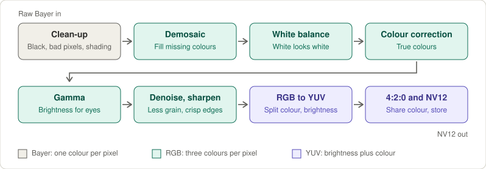

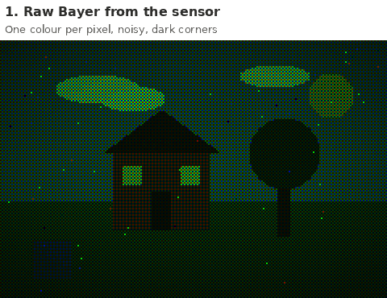

> The animation steps through the stages. The still version is in [section 5](#5-the-isp-stages-one-by-one).

---

### 2. The sensor: photodiodes

A sensor is a grid of millions of tiny **photodiodes**. Each one is about a micrometre wide, far thinner than a hair.

- A photodiode is a small patch of silicon with **two terminals** (a transistor has three).
- When light hits it, the light knocks electrons loose.
- Those electrons collect in it, like water in a bucket. **More light → more electrons → a bigger number.**
- There is no separate capacitor part. The photodiode itself stores the charge.

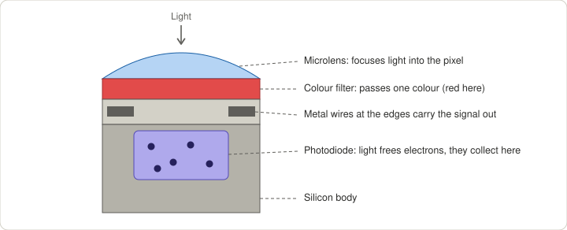

From top to bottom, one pixel is:

| Layer | What it does |
|---|---|
| Microlens | A tiny dome that bends light into the centre of the pixel so less is wasted on the wires |
| Colour filter | Lets only one colour through |
| Wiring | Thin metal wires at the edges that carry the signal out |
| Photodiode | The region inside the silicon where the freed electrons collect |

Next to each photodiode sit about four tiny transistors. They move the collected charge out, convert it to a voltage, connect this pixel to the output wire when its row is being read, and empty the bucket for the next frame.

**The "bucket" is not a physical cup.** It is an invisible electrical pocket inside the silicon, like a dip in the ground where rolling marbles collect.

---

### 3. The Bayer filter: why each pixel sees one colour

A photodiode is **colour-blind**. It only counts how much light arrived. Red light, green light and blue light all just fill the bucket.

So the sensor maker puts a tiny coloured filter on top of each photodiode. A red filter works like red glass: only red light passes. The photodiode underneath is still colour-blind, but now we know that whatever it counted must have been red.

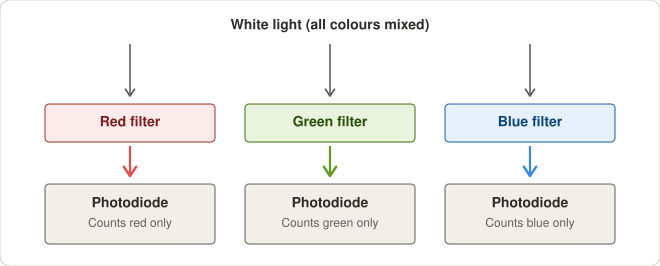

**One photodiode has only one filter.** The three colours come from neighbouring photodiodes:

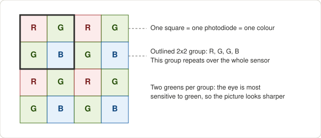

| Question | Answer |
|---|---|
| Why is it called Bayer? | The pattern was invented by Bryce Bayer at Kodak in the 1970s. |
| What is the pattern? | A 2×2 group of **R, G, G, B**, repeated across the whole sensor. |
| Why two greens? | The human eye is most sensitive to green, so extra green makes the picture look sharper. |
| Why not three photodiodes per pixel? | Three times the cost and size. With Bayer, one sensor is enough and the ISP rebuilds the missing colours. |

Zoomed far in, the raw data really does look like a mosaic of single-colour tiles:

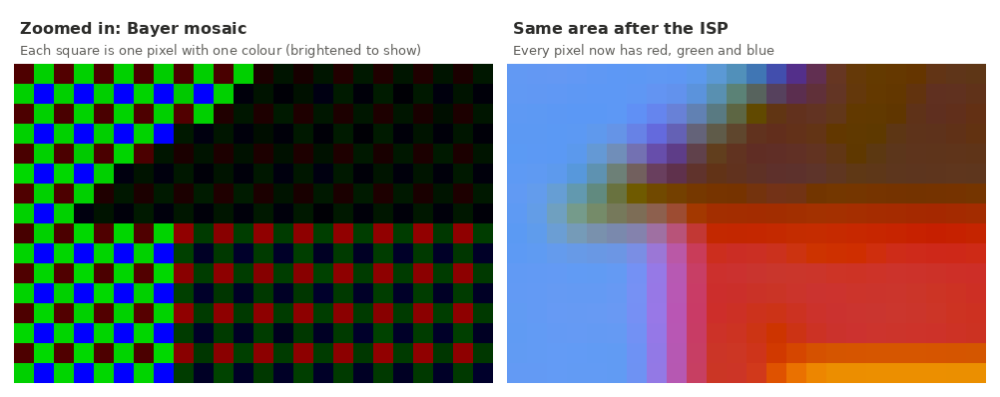

---

### 4. From the sensor to the ISP

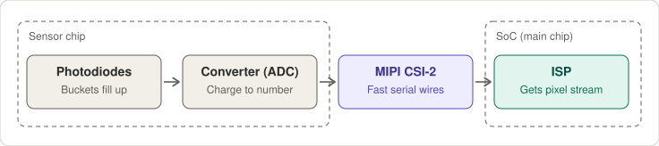

1. **Exposure.** For a few milliseconds every photodiode collects electrons. Longer exposure gives a brighter picture.
2. **Conversion.** The sensor goes row by row. For each photodiode a converter (**ADC**) measures how full the bucket is and writes it as a number. The ADC is a small circuit inside the sensor chip, usually one per column, so a whole row is converted at once.
3. **Sending.** The numbers go out in order: pixel by pixel, row by row, with small markers for *frame start*, *line start*, *line end* and *frame end*.
4. **Receiving.** A receiver on the main chip (the SoC) reads the stream and hands it to the ISP.

What reaches the ISP is **not a picture**. It is a long stream of numbers, one per photodiode. Each number means "this much red", "this much green" or "this much blue", depending on that photodiode's filter.

#### Inside the readout: from charge to a number

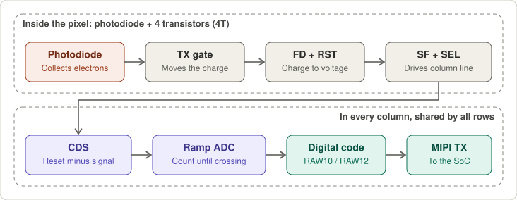

Each pixel is a photodiode plus four small transistors, so it is called a **4T pixel**:

| Part | Job |
|---|---|
| **TX** (transfer gate) | At readout time, moves the collected electrons out of the photodiode |
| **FD** (floating diffusion) | A tiny capacitor that receives the charge. Charge on a capacitor becomes a voltage, so this is where charge turns into voltage |
| **RST** (reset) | Empties the FD before each readout |
| **SF** (source follower) | A small amplifier that copies the FD voltage onto the long column wire without draining it |
| **SEL** (row select) | Connects this pixel to the column wire only when its row is being read |

Rows are read one after another, top to bottom. That is why most phone sensors are called **rolling shutter**: the top row is captured slightly earlier than the bottom row.

**CDS (correlated double sampling).** Every pixel has its own small offset and noise. So the column circuit measures each pixel twice: once right after reset (the "empty" level) and once after the charge has been moved in (the "signal" level). It keeps only the difference. The pixel's own offset appears in both measurements and cancels out.

**The single-slope (ramp) ADC.** Every column has its own simple ADC, so a whole row is converted at once:

1. A ramp voltage starts rising, and a counter starts counting at the same moment.
2. A comparator watches the ramp and the pixel voltage.
3. The moment the ramp crosses the pixel voltage, the comparator flips and the counter stops.
4. The number in the counter **is** the digital value of that pixel.

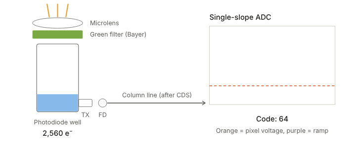

> Interactive version: download [`assets/pixel_adc.html`](assets/pixel_adc.html) and open it in a browser. Change the light, exposure and colour filter, then press Read out.

Two effects show up directly in the numbers:

- **Black level.** Even with no light, the code is not 0. The sensor adds a small offset (64 in the animation) so noise never goes below zero. This is exactly what black level correction removes in [section 5](#5-the-isp-stages-one-by-one).
- **Saturation.** When the bucket is full, more light adds nothing and the code sticks at the maximum (4095 for RAW12). Detail in that bright area is lost for good, which is why auto exposure tries to keep highlights below this point.

#### RAW8, RAW10, RAW12
The number after RAW is how many bits the ADC uses for each pixel. Raw data from a colour sensor is Bayer data, so "RAW10" and "Bayer 10-bit" mean the same thing.

| Format | Bits per pixel | Range of each number | Brightness levels |
|---|---|---|---|
| RAW8 | 8 | 0 to 255 | 256 |
| RAW10 | 10 | 0 to 1023 | 1,024 |
| RAW12 | 12 | 0 to 4095 | 4,096 |

**Why RAW10 or RAW12 instead of RAW8?** The ISP multiplies pixel values many times (white balance, lens shading, gamma). If you start with only 256 levels and stretch them, you get visible steps, called banding, especially in shadows and skies. More bits also let one frame hold both a bright window and a dark room. So the ISP takes in 10 or 12 bits, works at high precision, and reduces to 8 bits only at the output.

#### MIPI CSI-2: the wires between the sensor and the SoC

| Part of the name | Meaning |
|---|---|
| **MIPI** | Mobile Industry Processor Interface: a group of companies that agreed on common connections, so any maker's sensor works with any maker's SoC |
| **CSI** | Camera Serial Interface. "Serial" means the bits travel one after another on a few wires |
| **2** | The second version of the standard |

The link has one **clock lane** and one to four **data lanes**. Each lane is a pair of thin wires. More data lanes carry more pixels per second.

Each line of pixels travels inside a small **packet**, like a letter in an envelope:

- **Header:** a label saying which camera stream this is (the *virtual channel*, since one link can carry several streams), what kind of data is inside (for example RAW10), and how long it is.
- **Pixel data:** the numbers for one line.
- **Checksum:** a small code calculated from the pixel data, so the receiver can tell if anything was damaged on the way.

The receiver checks every packet and reports a problem as an error interrupt. The type of error tells you where to look:

| Error | What went wrong | Usually points to |
|---|---|---|
| Header error, 1 bit | One bit of the label flipped. The header carries a repair code, so it is fixed automatically | Normal now and then on a real board |
| Header error, 2 bits | Cannot be repaired. The packet is lost | Signal quality |
| Checksum (CRC) error | Pixel data does not match its checksum. One bad line | Cable, lane speed settings, signal quality |
| Start-of-packet error | The receiver missed where a packet begins | Signal quality or timing |
| Frame sync error | A frame end with no frame start before it, or the reverse | Sensor and receiver configured differently |
| Unknown data type or channel | The header names a type or stream the receiver was not set up for | Configuration mistake |

---

### 5. The ISP stages, one by one

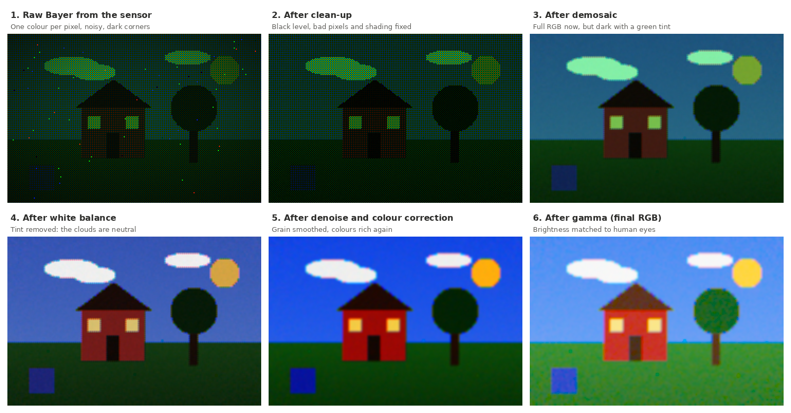

#### Stage A: clean-up (the data is still Bayer)

These three faults come from the sensor and the lens, not from the scene, so they are fixed first.

| Fix | The fault | What the ISP does | The name |
|---|---|---|---|
| **Black level correction** | Even in total darkness the buckets are never fully empty. A pixel that should read 0 reads a small value such as 64 | Subtracts that small amount from every pixel | It sets what "black" truly is |
| **Defective pixel correction** | Out of millions of photodiodes, a few are stuck bright or dead | Spots a pixel wildly different from its neighbours and replaces it using nearby pixels **of the same colour** | It repairs defective pixels |
| **Lens shading correction** | A lens sends more light to the centre than to the edges, so corners are darker | Brightens pixels more the further they are from the centre | The lens "shades" the corners |

#### Stage B: demosaic (Bayer becomes RGB)

Each pixel has one colour. A real picture needs red, green and blue at every pixel. The ISP gets the two missing colours by **borrowing from the neighbours**.

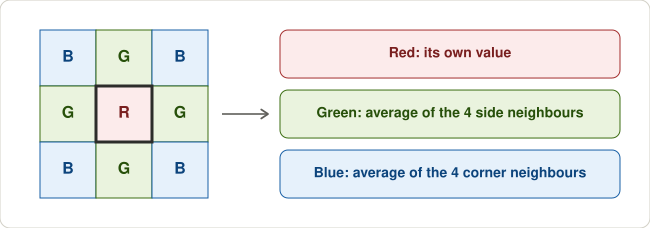

For a red pixel: its red value it already has, green comes from the four pixels on its sides, and blue comes from the four pixels at its corners. Green and blue pixels do the same with their own neighbours.

- **Why it works:** neighbouring pixels look at almost the same spot in the scene, so their colours are nearly the same.
- **The name:** the raw image is a mosaic of single-colour tiles. This step removes the mosaic: de-mosaic. It is also called debayering.
- **What changes:** before it, one number per pixel (Bayer). After it, three numbers per pixel (**RGB**). This is the moment the stream of numbers first becomes a colour picture, although it is still dark and tinted.

#### Stage C: making it look natural (the data stays RGB)

| Fix | The problem | What the ISP does | The name |
|---|---|---|---|
| **White balance** | Light is never pure white. A bulb is orange, a cloudy sky is bluish. Your brain corrects for this; a sensor cannot, so the picture is tinted | Turns red and blue up or down until white things look white | It balances the colours so white is white |
| **Colour correction** | The tiny filters are not perfect. The red filter lets a little green through, and so on, so colours look dull and slightly off | Untangles that mixing so red becomes a proper red. Often written **CCM**, colour correction matrix | It corrects the colours |
| **Gamma** | The sensor is linear: twice the light gives twice the number. Eyes are far more sensitive in dark areas, so raw numbers look much too dark | Lifts the dark and middle parts so the brightness matches what the eye expects | "Gamma" is the name of the curve used |
| **Noise reduction** | Random grain, worst in low light | Smooths it out | |
| **Sharpening** | Demosaic and noise reduction both soften the picture a little | Makes edges crisp again | |

After this stage the picture is **RGB and looks completely normal**. It could go straight to a screen.

> The exact order of stages varies a little between ISP designs. For example, white balance is often applied before demosaic. The ideas are the same.

#### What the picture looks like without each stage

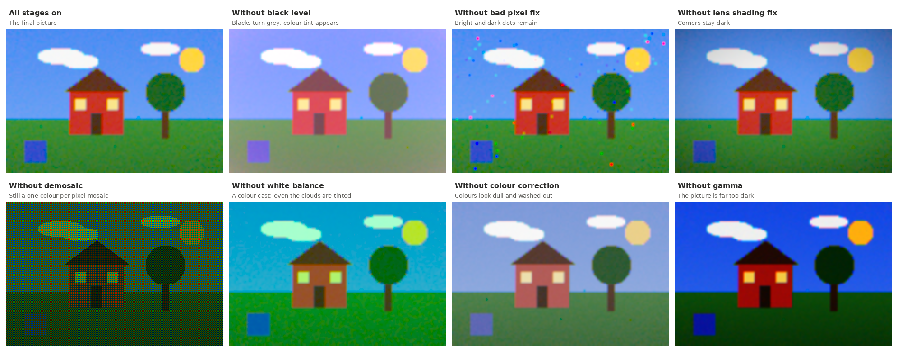

> Interactive version: download [`assets/isp_simulator.html`](assets/isp_simulator.html) and open it in a browser. Untick any stage to see its effect.

#### The 3A loop: statistics and feedback

While pixels flow through, the ISP also measures each frame: how bright it is overall, how much red, green and blue it has, how sharp it is. Firmware reads this summary once per frame and adjusts the settings for the next frame.

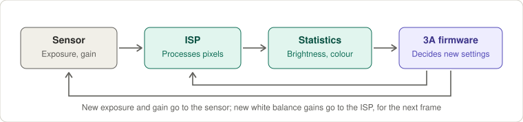

**3A** stands for **A**uto exposure, **A**uto white balance and **A**uto focus.

---

### 6. RGB to YUV

RGB describes a pixel as amounts of red, green and blue. **YUV** describes the same pixel in a different way:

| Letter | Meaning |
|---|---|
| **Y** | How bright the pixel is. On its own, Y is a black-and-white picture |
| **U** | How much bluer the pixel is than plain grey of that brightness |
| **V** | How much redder the pixel is than plain grey of that brightness |

Nothing is lost by switching. Three numbers go in and three come out, and you can convert back to exactly the same RGB. Green is not stored separately because it can be worked out from the other three. For a grey pixel, U and V are both zero.

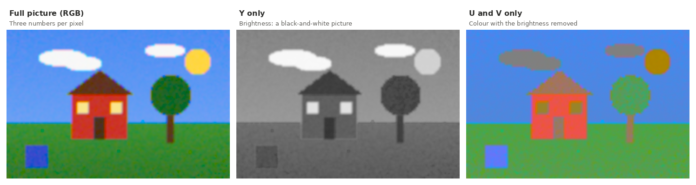

**Why does YUV exist? Two reasons.**

1. **Old televisions.** Early TV was black and white: the broadcast carried only brightness. When colour TV arrived, millions of homes still had black-and-white sets. Engineers split the signal into brightness (Y) plus two colour signals (U, V). Old sets used only Y and kept working. New sets used all three. A black-and-white screen could not show colour at all: each point of it could only glow brighter or darker.
2. **Saving space.** The eye has roughly 120 million cells that sense brightness and only about 6 million that sense colour. People notice a small loss of brightness detail at once but hardly notice a loss of colour detail. Once brightness and colour are separated, colour can be stored with less detail. In RGB that is impossible, because brightness is mixed into all three numbers.

**YUV does not make the picture look better.** RGB is for viewing. YUV is for storing and compressing: video encoders take YUV as input, and even a JPEG photo is stored this way. On playback, the decoder outputs YUV and it is converted back to RGB for the screen.

---

### 7. Sharing colour: 4:4:4, 4:2:2 and 4:2:0

Every pixel always keeps its own Y. The only question is how many pixels share one colour pair (one U and one V).

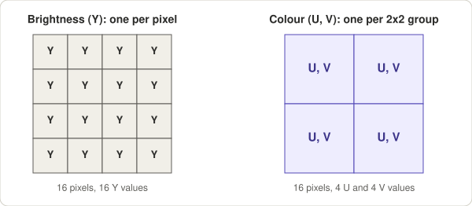

**A classroom picture.** Eight students sit in two rows of four. Every student has their own pencil (Y). The teacher hands out crayon boxes (U, V):

| Way of sharing | Crayon boxes for 8 students | Name |
|---|---|---|
| Everyone gets their own box | 8 | **4:4:4** |
| Two students sitting side by side share a box | 4 | **4:2:2** |
| Four students share a box: two in front, two right behind | 2 | **4:2:0** |

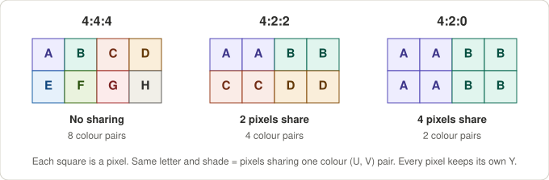

**What the three numbers mean.** Take a block 4 pixels wide and 2 rows tall, and count:

| | Pixels in a row | Colour pairs in row 1 | **New** colour pairs in row 2 |
|---|---|---|---|
| 4:4:4 | 4 | 4 | 4 |
| 4:2:2 | 4 | 2 | 2 |
| 4:2:0 | 4 | 2 | 0 (row 2 reuses row 1's) |

The `0` in 4:2:0 does **not** mean V is missing. U and V always travel together. It means the second row brings no new colour of its own.

**Sharing is local.** Lines work in pairs: lines 1 and 2 share one set of colours, lines 3 and 4 share a different set, and so on. Columns pair up the same way. The picture is therefore cut into small 2×2 squares, and each square has its own U and V. Colour is never shared across the whole frame.

**How much is saved.** For 16 pixels:

| | Numbers stored |
|---|---|
| RGB | 16 R + 16 G + 16 B = **48** |
| YUV 4:2:0 | 16 Y + 4 U + 4 V = **24** |

Half the data. The brightness is exact and the colour is slightly blurred, which the eye cannot see:

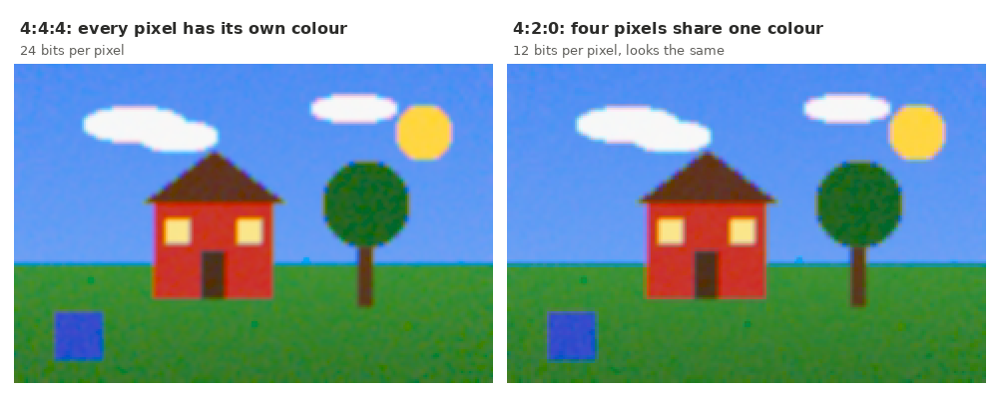

---

### 8. How the bytes sit in memory

A **plane** is one separate block of memory.

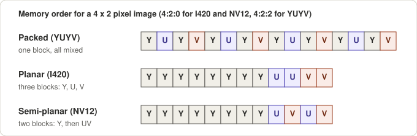

| Layout | Blocks | Arrangement |
|---|---|---|
| **Packed** | 1 | Y, U and V all mixed together |
| **Planar** | 3 | All Y, then all U, then all V |
| **Semi-planar** | 2 | All Y, then U and V mixed together. "Semi" because only Y gets its own block |

#### NV12

NV12 is semi-planar 4:2:0. For a 4×4 image:

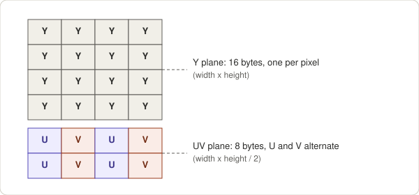

- First the **Y plane**: one byte per pixel.
- Then the **UV plane**: U, V, U, V… Each U, V pair belongs to one 2×2 square of pixels.
- The **12** is the average bits per pixel: 24 bytes for 16 pixels is 1.5 bytes each, which is 12 bits. (RGB is 24.)

**Why hardware prefers NV12**

- Encoders process brightness and colour separately, so Y needs its own block. Packed formats make that awkward.
- Two blocks need fewer address pointers than three.
- U and V are always used together, and here they sit side by side, so one read fetches both.

#### Common formats

| Format | Layout | Sharing | Bits per pixel | Notes |
|---|---|---|---|---|
| **NV12** | Semi-planar | 4:2:0 | 12 | The most common. What video encoders expect |
| NV21 | Semi-planar | 4:2:0 | 12 | Same as NV12 but V comes before U |
| **NV16** | Semi-planar | 4:2:2 | 16 | Better colour, used in broadcast |
| NV24 | Semi-planar | 4:4:4 | 24 | Full colour |
| **P010** | Semi-planar | 4:2:0 | 10-bit samples in 16-bit words | The 10-bit version of NV12, used for HDR |
| P210 | Semi-planar | 4:2:2 | 10-bit samples in 16-bit words | The 10-bit version of NV16 |
| **I420** (YU12) | Planar | 4:2:0 | 12 | Y, then U, then V. Common in software |
| YV12 | Planar | 4:2:0 | 12 | Same but V before U |
| **YUYV** (YUY2) | Packed | 4:2:2 | 16 | Order Y U Y V. Common from USB webcams |
| UYVY | Packed | 4:2:2 | 16 | Same data, order U Y V Y |
| RGB888 | Packed | none | 24 | For displays |
| GREY (Y8) | One plane | none | 8 | Brightness only |

In the NV names, the number is the bits per pixel: 12, 16, 24.

---

### 9. Size calculations

**Formula:** `width × height × bits per pixel ÷ 8 = bytes per frame`

#### A 128 × 64 frame (8,192 pixels)

| Format | Calculation | Size |
|---|---|---|
| RAW8 | 8,192 × 1 | 8,192 bytes |
| RAW10, packed | 8,192 × 10 ÷ 8 | 10,240 bytes |
| RAW10, stored in 16-bit words | 8,192 × 2 | 16,384 bytes |
| RAW12, packed | 8,192 × 12 ÷ 8 | 12,288 bytes |
| RGB888 or YUV 4:4:4 | 8,192 × 3 | 24,576 bytes |
| YUV 4:2:2 (YUYV, NV16) | 8,192 × 2 | 16,384 bytes |
| **NV12** | Y: 8,192 + UV: 64 × 32 × 2 = 4,096 | **12,288 bytes** |

In NV12 that frame has 8,192 Y values and 64 × 32 = 2,048 squares, so 2,048 U values and 2,048 V values.

#### Why raw video cannot simply be stored: 1920 × 1080 at 60 frames per second

| Format | One frame | Per second | One minute |
|---|---|---|---|
| RAW10 | 2.59 MB | 155.5 MB | 9.33 GB |
| RGB888 | 6.22 MB | 373 MB | 22.4 GB |
| NV12 | 3.11 MB | 186.6 MB | 11.2 GB |
| Encoded video (about 8 Mbit/s) | n/a | 1 MB | 60 MB |

That is why the chain is always sensor → ISP → NV12 → video encoder. The encoder shrinks the data by well over a hundred times.

---

### 10. How a hard ISP works inside

A **hard ISP** is a fixed circuit built into the chip only for this job. Think of a car factory: cars move along a belt, and each worker does one fixed job as the car passes.

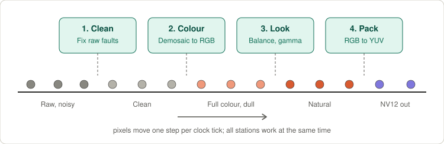

1. **Pixels arrive one by one, never as a whole picture.** The ISP starts on the first pixel while the sensor is still capturing the rest of the frame.
2. **Each station is a fixed circuit that does one job.** It cannot do anything else, which is exactly why it is fast and uses little power.
3. **All stations work at the same time.** While the last station handles pixel 1, the one before it is already on pixel 2. One finished pixel comes out on every clock tick, even though each pixel passed through many steps.
4. **Software does not touch the pixels.** The driver only writes settings into registers: enable this stage, use this gain, use this resolution. Then the hardware runs by itself.

**Line buffers.** Some stages (demosaic, defective pixel correction, noise reduction) need a pixel's neighbours above and below. Since pixels arrive one line at a time, the hardware keeps the last few lines in a small memory called a line buffer. It never stores the whole frame.

#### Interrupts in normal operation

The CPU is not watching the pixels, so the ISP taps it on the shoulder when something happens.

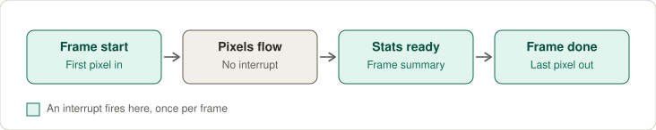

| Interrupt | Meaning | What the driver does |
|---|---|---|
| Frame start | The first pixel of a new frame has arrived | Notes the timestamp |
| Statistics ready | The frame summary for 3A is available | Firmware reads it and updates exposure, gain and white balance |
| Frame done | The last pixel has been written out | Passes the full buffer on and gives the ISP an empty one |

These happen on every frame. At 60 frames per second there are 60 of each per second, so counting them is the simplest health check. If they stop, the pipeline has stalled.

Error interrupts report problems: the MIPI errors from section 4, a frame with the wrong number of lines or pixels, or an overflow when data arrives faster than the next block can take it.

#### The ISP's two doors: IBA and OBA

Many SoC ISPs have a dedicated block at each end of the pipeline. In AMD's Versal AI Edge Gen 2 ISP (product guide PG432) they are called the **IBA** (input buffer adapter) and the **OBA** (output buffer adapter).

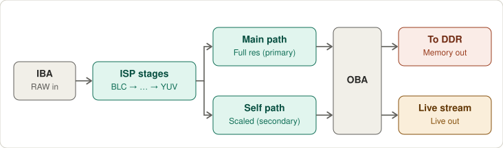

| Door | What passes through it |
|---|---|
| **IBA** | The RAW stream coming in: RAW8, 10, 12 or 16, at 1, 2 or 4 pixels per clock. An ISP can have several IBAs (one per camera stream) feeding the same ISP core |
| **OBA** | The finished picture going out: a primary and a secondary output, each with its own format and size |

**Inside the IBA.** These are the typical jobs of an input adapter; the exact register and bit names are in the ISP's own register specification.

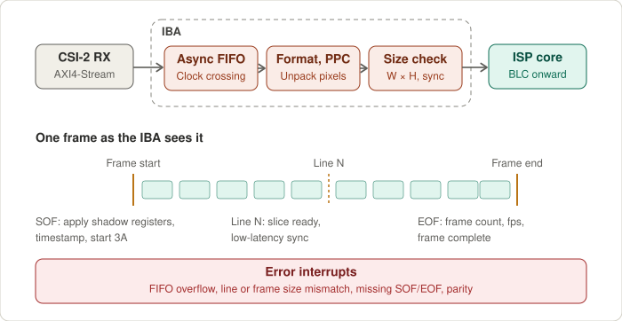

| Job | Why it is needed |
|---|---|
| Clock crossing | The MIPI receiver and the ISP core run on different clocks. A small async FIFO hands pixels safely from one clock to the other |
| Format and pixels-per-clock | Unpacks RAW10 or RAW12 into whole pixel values and sets how many pixels move on each clock |
| Size and sync check | Counts pixels per line and lines per frame against the programmed width and height, and produces clean frame start and frame end signals for the rest of the ISP |

**What the IBA and OBA interrupts are used for**

| Interrupt | Meaning | What it is used for |
|---|---|---|
| Frame start (SOF) | A new frame is entering | The safe moment to update the ISP's **shadow registers**: new 3A, white balance and colour settings take effect for a whole frame, never in the middle of one. Also used to timestamp the frame |
| Line N (if present) | N lines have arrived | Slice-level sync in low-latency mode (topic 02) |
| Frame end (EOF) / frame done | The whole frame is in, or out | Frame counting, measuring fps, handing the finished buffer to the next block |
| Input overflow (IBA) | Pixels arrived faster than the core took them | Core clock too low for the pixel rate, or the core was stalled by back-pressure from the output side |
| Size mismatch | A short or long line, or a short or long frame | Sensor and ISP programmed for different resolutions, or MIPI packets were lost |
| Missing SOF or EOF | Frame sync was lost | The sensor stopped streaming or the link broke in the middle of a frame |
| Output overflow (OBA) | The next block or the memory writes could not keep up | Downstream back-pressure, or not enough DDR bandwidth |
| Parity error | A bit flipped in one of the ISP's internal memories | Functional safety: the error is reported to the system's error manager (see section 12) |

PG432 sizes the minimum ISP core clock as the sum of width × height × frame rate × 1.2 over all streams on that core. The extra 20% is headroom, so the core always drains the input FIFO faster than the sensor fills it.

**Debug order for a bad or missing frame.** Follow the data:

1. **No frame start at all:** the problem is before the ISP (sensor not streaming, MIPI receiver, lanes).
2. **Frame start, then a size error:** the sensor and the IBA disagree on resolution, or packets are being lost.
3. **Overflow:** check the core clock against the pixel rate, then check what is blocking the output.
4. **IBA is clean but the picture is wrong:** move to the OBA, then to whatever reads its output.

#### Two outputs: main path and self path

Older ISP designs and their Linux drivers (for example the Rockchip ISP driver, with its `mainpath` and `selfpath` video nodes) call the two outputs the **main path** and the **self path**. PG432 calls them the **primary** and **secondary** output. Same idea:

| | Main path (primary) | Self path (secondary) |
|---|---|---|
| Resolution | Full, best quality | Usually scaled down |
| Typical formats | YUV 4:2:0 or 4:2:2, sometimes RAW | YUV or RGB, often with flip and rotate |
| Typical user | Video encoder, recording, still capture | Preview on a display, or an AI or analytics engine |

Both come from the same processed picture, so one camera can feed a recording and a live preview at the same time.

#### Where the output goes: memory or live

Each output either goes into memory or streams straight on. PG432 names the ISP's input/output modes **LILO** and **LIMO** (and **MIMO** for memory input). The letters read as Live In / Memory In, Live Out / Memory Out:

| Mode | Input | Output | What it means |
|---|---|---|---|
| **LILO** | Live from the sensor | Live stream | No frame stored anywhere. Lowest delay, but every block downstream must keep up in real time |
| **LIMO** | Live from the sensor | Memory (DDR) | Frames are written to DDR. The next block (for example the video encoder) reads them from there |
| **MIMO** | From memory | Memory | A stored frame is processed, for example for testing or re-processing |

What happens after the OBA (frame buffers, the encoder, low-latency mode and the Sync IP) is covered in [topic 02](../02_ISP_to_Video_Encoder/README.md).

---

### 11. Soft ISP, and hard versus soft

A **soft ISP** does exactly the same steps as a program on the ordinary CPU or GPU.

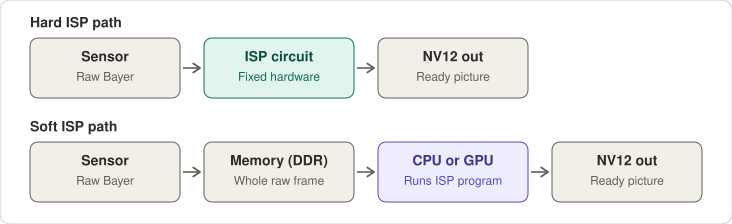

1. The sensor sends raw Bayer data, as before.
2. With no ISP circuit to catch it, the whole raw frame is first saved in memory.
3. A program goes through the frame pixel by pixel and performs each stage with ordinary instructions.
4. The result is written back to memory as NV12.

It is the same recipe. In a hard ISP a dedicated machine cooks it. In a soft ISP a general-purpose cook follows the recipe by hand.

**If soft does the same job, why build a hard ISP?** Because of the workload. A 4K camera at 60 frames per second produces about 500 million pixels every second, and each pixel needs many small operations. A fixed circuit handles that easily. A CPU doing it one step at a time would be fully busy and running hot, with nothing left for the rest of the system.

| | Hard ISP | Soft ISP |
|---|---|---|
| Speed | Very fast, 4K at 60 fps is routine | Slow, often limited to low resolution or frame rate |
| Power | Very low | High |
| Delay | Almost none, pixels flow straight through | At least one frame, since the frame is stored first |
| CPU left for other work | Nearly all of it | Very little |
| Memory traffic | Low | High: the raw frame is written and read back |
| Flexibility | Fixed after manufacture | Easy to change with a software update |
| Chip cost | Adds silicon area | No extra hardware |

| Use a hard ISP for | Use a soft ISP for |
|---|---|
| Phones, cars, security cameras, drones | Low-cost boards with no ISP hardware |
| High resolution and real-time response | Early bring-up before the ISP driver is ready |
| Long battery life | Trying out a new algorithm, low-resolution cameras |

> "Soft ISP" can have a second meaning: an ISP design loaded into the programmable logic of an FPGA. That is still circuits working in parallel, so it is fast like hardware, but it uses up programmable logic and more power than a block built permanently into the chip.

---

### 12. What to check when validating an ISP

| Area | Typical checks |
|---|---|
| Registers | Reset values, read and write access |
| Function | Output frame matches a known-good reference (compare a CRC or checksum of the frame) |
| Each stage | Enable and bypass every stage on its own, and check the output changes as expected |
| Formats and sizes | Every supported input bit depth, output format and resolution, including the smallest and largest |
| Interrupts | Frame start, statistics ready and frame done counts match the frame rate; each status bit sets and clears correctly |
| Error handling | Inject a fault (short frame, corrupted packet, wrong data type) and check the right error is reported and the pipeline recovers |
| Clock, reset, power | Reset in the middle of a frame, clock gating, power-down and resume |
| Performance | Frame rate, latency, memory bandwidth at the highest resolution |
| Stress | Long runs, several streams together, switching resolution on the fly |
| Functional safety | The ISP's internal memories (line buffers, lookup tables) and settings are protected by parity or ECC. Inject a bit flip, then check that the error is detected, that it reaches the error manager, and that the planned safety reaction (stop or reset the stream) happens |

---

### 13. Summary table

| Step | Where | What happens | Data after it |
|---|---|---|---|
| 1 | Sensor | Photodiodes collect light through red, green or blue filters | One colour per pixel |
| 2 | Sensor | The ADC turns each bucket into a number | RAW10 or RAW12 (Bayer) |
| 3 | MIPI CSI-2 | Numbers travel to the SoC in packets, row by row | Bayer stream |
| 4 | ISP | Clean-up: black level, defective pixels, lens shading | Clean Bayer |
| 5 | ISP | Demosaic: borrow missing colours from neighbours | RGB |
| 6 | ISP | White balance, colour correction, gamma, denoise, sharpen | Good-looking RGB |
| 7 | ISP | Convert to YUV and share colour among four pixels | YUV 4:2:0 |
| 8 | Memory | Y plane, then interleaved UV plane | NV12, ready for the encoder |

**Key facts**

- A photodiode is colour-blind. The filter on top decides which colour it measures.
- Raw Bayer cannot be viewed directly. RGB can.
- YUV is for storing and encoding, not for looking better.
- 4:2:0 means one colour pair for every 2×2 square of pixels.
- NV12 is semi-planar: Y in one block, U and V mixed in the other, 12 bits per pixel.
- A hard ISP is a fixed circuit: fast and low-power. A soft ISP is a program: flexible but slow.

#### Glossary

| Term | Meaning |
|---|---|
| ADC | Analog-to-digital converter: turns the charge in a pixel into a number |
| Bayer | The R, G, G, B colour filter pattern, and the raw data it produces |
| BLC / DPC / LSC | Black level, defective pixel and lens shading correction |
| CCM | Colour correction matrix |
| Chroma | The colour part of a picture (U and V) |
| Luma | The brightness part of a picture (Y) |
| Demosaic | Rebuilding full RGB at every pixel from Bayer data |
| 3A | Auto exposure, auto white balance, auto focus |
| Plane | One separate block of memory holding one kind of sample |
| SoC | System on chip: the main chip that contains the CPU, ISP and other blocks |
| 4T pixel | A photodiode with four transistors: transfer, reset, source follower and row select |
| CDS | Correlated double sampling: read each pixel at reset and after charge transfer, keep the difference |
| Single-slope ADC | A ramp plus a counter; the count when the ramp crosses the pixel voltage is the pixel value |
| IBA / OBA | Input and output buffer adapters: the ISP's input and output doors |
| Main path / self path | The ISP's two outputs, also called primary and secondary |
| Shadow registers | A second copy of the settings that the hardware switches to only at frame start |
| LILO / LIMO / MIMO | ISP modes: live or memory input, live or memory output |

#### Further reading

- [What is a Bayer pattern and an ISP (e-con Systems)](https://www.e-consystems.com/blog/camera/?p=7388)
- [The ISP pipeline (OpenMV tutorial)](https://docs.openmv.io/openmvcam/tutorial/vision/color/isp-pipeline.html)
- [A peek inside your camera: the ISP pipeline (eInfochips)](https://www.einfochips.com/blog/a-peek-inside-your-camera-i-image-signal-processing-isp-pipeline/)
- [YUV pixel formats (VideoLAN wiki)](https://wiki.videolan.org/YUV)
- [Planar and semi-planar YUV formats (Linux kernel documentation)](https://docs.kernel.org/6.0/userspace-api/media/v4l/pixfmt-yuv-planar.html)
- [Versal AI Edge Series Gen 2 ISP product guide, PG432 (AMD)](https://docs.amd.com/r/en-US/pg432-versal-ai-edge-series-gen-2-isp/Inputs-Tab)
- [ISP tiles in the Versal SoC design guide, UG1273 (AMD)](https://docs.amd.com/r/2025.1-English/ug1273-versal-acap-design/ISP)

---

## Interview One-liner
*"The sensor is colour-blind, so a Bayer filter gives one colour per pixel as RAW10 or RAW12 over MIPI CSI-2. The ISP cleans it, demosaics to RGB, fixes white balance, colour and gamma, then converts to YUV 4:2:0 and stores it as NV12, which is what the encoder takes."*
