# 02 · From the ISP to the video encoder: buffers, low latency, slices and codecs

[Topic 01](../01_Camera_ISP/README.md) ended with the ISP producing NV12 at its output door, the OBA. This topic follows that picture onwards: how it gets into memory, how the video encoder (the VCU, video codec unit) finds it, how low-latency mode lets the encoder start before the frame is finished, and what the encoder does with it: blocks, macroblocks, CTUs and slices. The focus is the SoC view: which block talks to which, where the data actually lives, and what can go wrong.

---

## Theory

### 1. The big picture: three ways out of the ISP

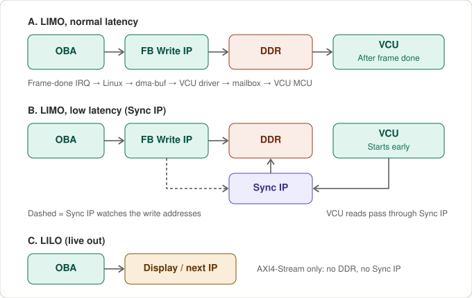

| Setup | Data path | When the encoder starts | Delay |
|---|---|---|---|
| **A. LIMO, normal latency** | OBA → frame buffer write IP → DDR → VCU | After the **frame done** interrupt | At least one frame |
| **B. LIMO, low latency** | Same data path as A, plus a **Sync IP** guarding the encoder's reads | As soon as the buffer is handed over, slice by slice | About one slice |
| **C. LILO, live out** | OBA → AXI4-Stream → display or another IP | No memory involved | A few lines |

Three points that are easy to mix up:

- **Low latency is still a memory mode.** In setup B the pixels still go through DDR. The difference from A is only *when* the encoder is allowed to start reading.
- **The Sync IP belongs to setup B, not to LILO.** In LILO nothing is written to memory, so there is nothing for a Sync IP to watch.
- **The OBA does not hold frames.** It has only small FIFOs, a few lines deep. One slice of a 1080p frame is about 400 KB, so frames and slices always live in DDR, never inside the ISP.

Many hardware encoders read their input frames from memory over AXI. For such an encoder, low-latency mode is setup B (DDR plus Sync IP), not a direct live stream from the ISP.

---

### 2. Frame-buffer mode vs low-latency mode

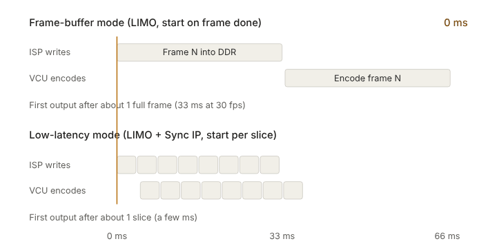

> Interactive version: download [`assets/latency_timeline.html`](assets/latency_timeline.html) and open it in a browser.

**Frame-buffer mode (A).** The frame buffer write IP writes the whole frame to DDR and raises **frame done**. Only then does software hand the buffer to the encoder. At 30 fps one frame takes 33 ms, so the encoder's first output comes at least 33 ms after the first pixel, plus the encoding time.

- **Strength:** the ISP and the encoder are decoupled. If either one stalls briefly, the buffer absorbs it.
- **Frame done means complete, not correct.** It guarantees that every pixel was written before the encoder reads. Bad data from upstream (a sensor or MIPI error) is still encoded faithfully, so the error interrupts from topic 01 still matter.

**Low-latency mode (B).** The frame is cut into horizontal **slices** (section 11). The encoder starts on slice 0 as soon as it has been written, while the ISP is still writing slice 1. Working in slice mode cuts the encoder's processing latency from one frame to one frame divided by the number of slices.

- **Cost:** there is no full-frame slack any more. Every stage (ISP clock, DDR bandwidth and QoS, encoder throughput) must keep up with the sensor's pixel rate in real time.
- **Typical users:** video calls, drones, cars, AR glasses: anything where a person or a control loop reacts to the picture.
- **Frame-buffer mode suits** recording and storage, where robustness matters more than delay.

---

### 3. The Sync IP: how low latency stays safe

If the encoder starts early, the obvious danger is that it reads lines the ISP has not written yet. The **Sync IP** prevents this.

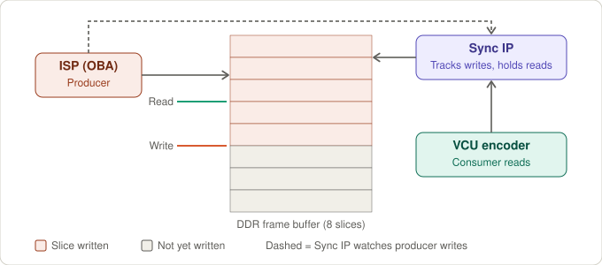

1. Software programs the Sync IP for each buffer with the luma and chroma **start and end addresses**, for both the producer (the frame buffer write IP) and the consumer (the VCU).
2. The Sync IP **watches the producer's AXI write addresses** (the dashed line). From them it always knows how far down the frame the writing has got.
3. The encoder's **read requests pass through the Sync IP**. A read below the written point goes straight through. A read beyond it is **held** until that slice has been written. In short: the Sync IP blocks the consumer's transactions until the producer has finished writing a slice of data to memory.
4. The producer gives the consumer an **early buffer done** signal as soon as writing starts, so the encoder gets the buffer immediately and the Sync IP stops it from overtaking the writer.

Because the Sync IP works out progress from the addresses itself, the frame buffer write IP still needs only its normal **frame done** interrupt. No per-slice interrupt is needed.

---

### 4. What can still go wrong

| Setup | Can the picture be corrupted? | How | What catches it |
|---|---|---|---|
| A. LIMO, frame done | Rarely | Too few buffers: the ISP starts overwriting a buffer the encoder is still reading | Buffer bookkeeping in the driver; use three or more buffers |
| B. LIMO + Sync IP | Only if misconfigured | A wrong end address or line pitch makes the gate open too early (a torn frame) or never (a hang). A stalled producer blocks the encoder: a latency spike or timeout | Sync IP status and error interrupts, encoder timeouts |
| C. LILO | Yes, by **overflow** | Pixels are pushed in order, so read-before-write cannot happen. But a sensor cannot pause: if the next block stalls for longer than the FIFOs can absorb, pixels are dropped, giving shifted, torn or green lines | IBA and OBA overflow and size-mismatch interrupts |

In one line: **in setup B the risk is reading too early, and the Sync IP prevents it. In setup C the risk is not keeping up, and nothing can prevent it.** The FIFOs absorb short stalls, and the overflow interrupts report the long ones.

---

### 5. How the buffers get their DDR addresses

A typical capture-and-encode command never mentions a memory address:

```sh
gst-launch-1.0 v4l2src device=/dev/video0 io-mode=dmabuf \
  ! video/x-raw,format=NV12,width=1920,height=1080,framerate=60/1 \
  ! <h265-hw-encoder> num-slices=8 target-bitrate=8000 \
  ! h265parse ! filesink location=out.h265
```

> `<h265-hw-encoder>` stands for the board's hardware H.265 encoder element. Element and property names vary between platforms; this shows the shape of a pipeline, not an exact recipe.

The addresses are handled entirely by the Linux kernel:

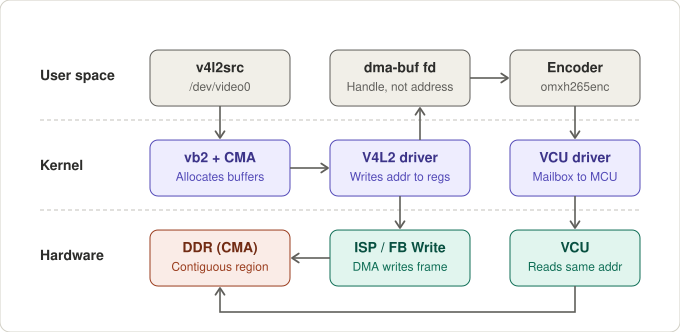

1. `v4l2src` opens `/dev/video0` and asks the driver for a few buffers (`VIDIOC_REQBUFS`).
2. The kernel's video buffer layer, **videobuf2 (vb2)**, allocates them from **CMA** (the contiguous memory allocator), a region of DDR reserved at boot. DMA engines need physically contiguous memory (or an IOMMU to stitch pages together), and CMA provides it. The driver also applies the hardware's line-pitch and alignment rules here.
3. When a buffer is queued (`VIDIOC_QBUF`), the **V4L2 driver writes that buffer's DMA address into the ISP or frame buffer write IP registers**. This is where the DDR address actually goes.
4. The hardware writes the frame and raises frame done. The driver marks the buffer done, and user space dequeues it (`VIDIOC_DQBUF`).
5. GStreamer receives a **dma-buf file descriptor**: a handle to the buffer, not an address. It passes this handle to the encoder element. No pixels are copied (**zero-copy**).
6. The encoder driver imports the dma-buf, looks up the same physical address and gives it to the VCU. In low-latency mode the same addresses are also programmed into the Sync IP.

User space only ever moves handles around. Physical addresses stay inside the kernel.

**The mailbox to the VCU.** The VCU has its own small microcontroller (the MCU) running the codec firmware, and Linux talks to it through a **mailbox**:

1. The Linux VCU driver writes a message into shared memory: "encode the frame at this address, with these settings".
2. It raises an interrupt, the **doorbell**, to tell the MCU a message is waiting.
3. The MCU programs the encoder hardware. When the frame or slice is done, it replies through the mailbox with another interrupt: "done, the bitstream is at this address".

So a buffer address travels: V4L2 buffer → dma-buf → VCU driver → mailbox → VCU MCU → encoder hardware.

**Useful checks on a board**

| Command | Shows |
|---|---|
| `grep -i cma /proc/meminfo` | Total and free CMA. If allocation fails, enlarge it with `cma=1024M` on the kernel command line or a `reserved-memory` node in the device tree |
| `dmesg` | Buffer allocation errors and driver messages |
| `media-ctl -p` | The capture pipeline graph: sensor → receiver → ISP → video node |
| `v4l2-ctl --all -d /dev/video0` | The format, size and buffer settings the driver agreed on |

---

### 6. H.264 and H.265: two compression standards

H.264 and H.265 are **not** "the encoder" and "the decoder". Each is a complete **video compression standard**, and each has its own encoder and decoder. The VCU can encode and decode both.

| | H.264 | H.265 |
|---|---|---|
| Other name | AVC (Advanced Video Coding) | HEVC (High Efficiency Video Coding) |
| Published | 2003 | 2013 |
| Basic block | Fixed 16×16 **macroblock** | **CTU** (coding tree unit) of 16, 32 or 64; many hardware encoders use 32×32. It is split by a quadtree down to 8×8 |
| Compression | Baseline | About **half the bitrate** for the same quality |
| Cost | Lighter hardware | More computation and bigger on-chip buffers |
| Typical use | Video calls, older devices, widest compatibility | 4K, storage, streaming where bandwidth costs money |

---

### 7. Why a frame is split into blocks

An encoder cannot compress a whole frame in one go. Every compression step works on a small area, because pixels close together usually look alike.

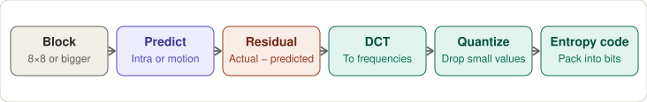

1. **Prediction needs a small area.** For each block the encoder guesses the pixels, either from the neighbouring pixels in the same frame (**intra**) or from a **motion vector** into the previous frame (**inter**: "this block is that block, moved three pixels right"). Different parts of the picture move differently (a balloon drifts, people walk, the sky stays still), so each block gets its own motion vector. One vector for the whole frame would be useless.
2. **Only the leftover is sent.** Residual = actual − predicted. For a flat block it is almost zero.
3. **The transform works on blocks.** The DCT (discrete cosine transform) turns the residual into frequencies. A smooth block becomes a few numbers and many zeros. **Quantization** then drops the small values, and the entropy coder packs the rest into bits. Zeros cost almost nothing.
4. **Hardware needs fixed-size work units.** A block fits in on-chip memory, the steps can be pipelined (fetch → predict → transform → code), memory reads come in predictable bursts, and slices are built from rows of blocks.

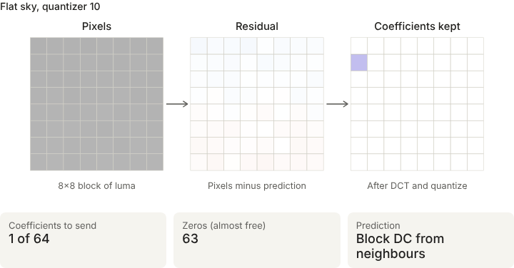

> Interactive version: download [`assets/block_compression.html`](assets/block_compression.html) and open it in a browser. Raise the quantizer and watch the coefficient count fall.

Flat sky needs almost no coefficients, a sharp edge needs a few, and tree leaves need most of them. That difference is the whole reason block **size** matters.

---

### 8. Macroblocks and CTUs

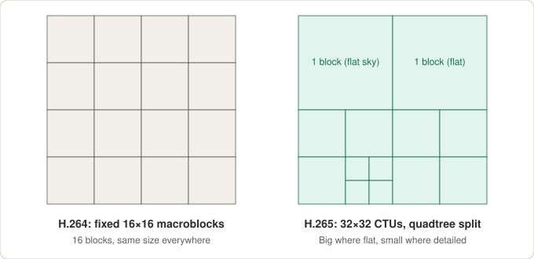

**H.264** was designed in the standard-definition era, when a fixed 16×16 block was a good balance between detail and hardware cost. A macroblock can be divided further for prediction and transform, but the grid itself is fixed.

**H.265** was designed for HD and 4K, where large areas (sky, walls, roads) are smooth. A **CTU** is the H.265 tile:

| Level | What it is | What it decides |
|---|---|---|
| **CTU** | The tile, for example 32×32 | Holds a luma block and its two chroma blocks |
| **CU** (coding unit) | A square from the quadtree split: 32, 16 or 8 | Intra or inter prediction |
| **PU** (prediction unit) | A part of a CU | Carries the motion vectors |
| **TU** (transform unit) | A part of a CU | The residual block that is transformed and quantized |

A big CU covers a flat area with one set of decisions, which saves bits. The quadtree splits only where there is detail. The standard allows CTUs up to 64×64. Many hardware encoders stop at 32×32 because bigger CTUs need bigger on-chip line buffers and more memory bandwidth per row. This is also why H.265 slices on such an encoder are counted in 32-line rows.

---

### 9. The same picture in AVC and in HEVC

A busy test picture: sky in the middle, a balloon, a clock tower, people, a tree, a building, a brick wall and flowers. Open each view below to compare.

<details>
<summary><b>The picture</b></summary>


</details>

<details>
<summary><b>H.264 / AVC: fixed 16×16 macroblocks</b></summary>

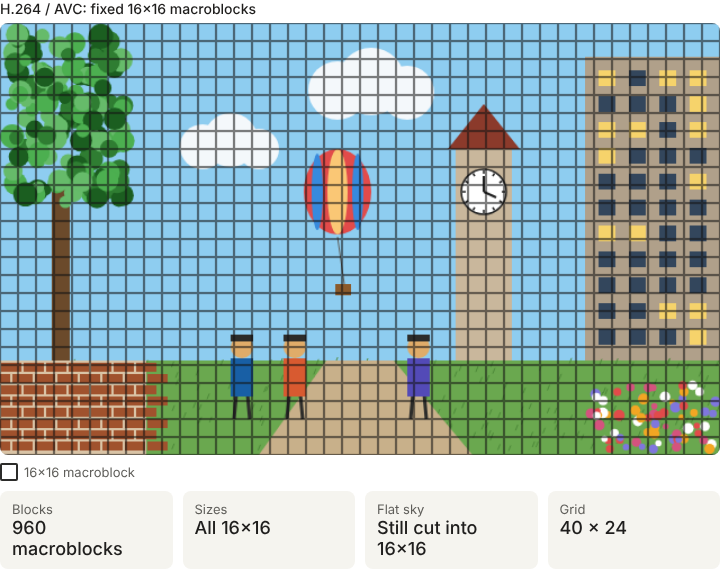

</details>

<details open>
<summary><b>H.265 / HEVC: 32×32 CTUs with quadtree split</b></summary>

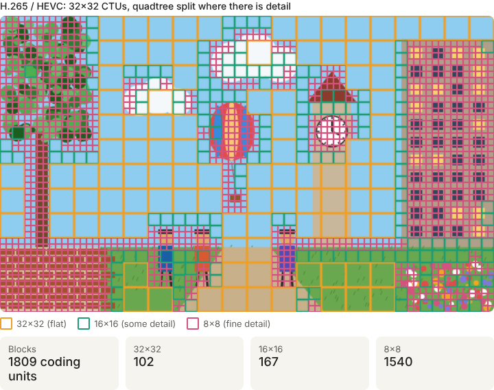

</details>

All three, one after another:

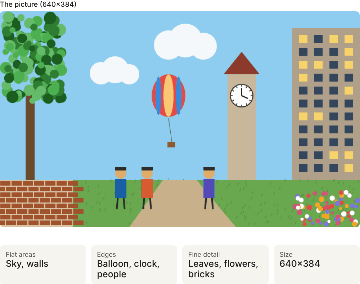

> Interactive version: download [`assets/avc_vs_hevc_scene.html`](assets/avc_vs_hevc_scene.html) and open it in a browser. Switch between the three views and move the split sensitivity.

The split rule in these pictures is a simple "how much detail is in this block" test. A real encoder decides by rate-distortion optimisation (section 10), but the pattern is the same.

| Region | AVC (fixed 16×16) | HEVC (32×32 CTU, quadtree) |
|---|---|---|
| Open sky, building wall | Still cut into many 16×16 blocks, each with its own header and mode bits | One 32×32 block covers what AVC needs four macroblocks for |
| Balloon edge, clock face | 16×16 blocks straddle the edge | Splits to 16 or 8 only around the edge |
| Leaves, flowers, bricks, people | Uniform 16×16 | Mostly 8×8, following the fine detail |

**Why this saves bits.** Every block costs overhead (mode, motion vector, flags). HEVC spends a few large blocks on flat areas and many small ones only where there is detail. That adaptive split, together with better prediction and larger transforms, is where most of the roughly 50% saving comes from. The price is that the encoder must try many split options per CTU.

---

### 10. Who decides the block split

Nobody sets the split directly. The encoder's **mode decision**, in the VCU hardware and firmware, chooses it for every CTU by **rate-distortion optimisation (RDO)**:

> cost J = distortion + λ × rate (bits)

For each CTU it tries the options (no split, split to 16, split to 8, intra or inter) and keeps the one with the lowest cost.

The user controls **λ** indirectly, through the normal encoder settings:

| Setting | Example properties | Effect |
|---|---|---|
| Rate control | `control-rate` (constant, variable, constant QP), `target-bitrate` | Sets the bit budget |
| QP (quantization parameter) | `min-qp`, `max-qp`, `qp-mode` (including region-of-interest) | λ is derived from QP |

> Property names differ between encoders; the ideas are the same.

A lower bitrate means a higher QP and a higher λ. Bits become "expensive", so the encoder picks **bigger blocks** and keeps fewer coefficients. A higher bitrate does the opposite: more fine splits and more detail. The split sensitivity slider in the interactive page stands in for this effect.

---

### 11. Slices

A **slice** is a horizontal band of the frame made of **whole block rows**: 16-line macroblock rows in H.264, 32-line CTU rows in H.265 with 32×32 CTUs. It is not a few bytes and not a single line. The encoder compresses each slice independently: prediction does not cross a slice boundary, and each slice has its own header.

**Who sets the number of slices.** It is an **encoder setting chosen by software** when the encoder is set up, for example `num-slices` on the GStreamer encoder element or the slice setting in the encoder's configuration file. The **default is one slice per frame**, which is why a normal pipeline never mentions it. The ISP knows nothing about slices; it just writes lines. The hardware design settings size the encoder's resources (maximum resolution, number of streams, buffers); the slice count is chosen per stream at run time.

**How slices are calculated**

1. **Pad the height to the block size:** coded height = round up (height ÷ block) × block. The decoder crops the extra lines.
2. **Count the block rows:** rows = coded height ÷ block.
3. **Share the rows among the slices:** rows ÷ number of slices. If it does not divide evenly, some slices get one extra row. You cannot have more slices than rows.
4. **Size of one slice:** lines = rows in the slice × block. Bytes (NV12, 8-bit) = width × lines × 1.5. Time = lines ÷ coded height × frame time.

**Worked examples, 8 slices requested, 60 fps**

| | 1920×1080, H.265 (32) | 1920×1080, H.264 (16) | 128×64, H.265 (32) | 128×64, H.264 (16) |
|---|---|---|---|---|
| Coded size | 1920×1088 | 1920×1088 | 128×64 | 128×64 |
| Block grid | 60 × 34 CTUs | 120 × 68 MBs | 4 × 2 CTUs | 8 × 4 MBs |
| Slices actually used | 8 | 8 | **2** (only 2 rows) | **4** (only 4 rows) |
| Rows per slice | 5, 5, 4, 4, 4, 4, 4, 4 | 9, 9, 9, 9, 8, 8, 8, 8 | 1 each | 1 each |
| Lines per slice | 160 or 128 | 144 or 128 | 32 | 16 |
| Bytes per slice (NV12) | 360 to 450 KB | 360 to 405 KB | 6,144 B | 3,072 B |
| Time per slice | 1.96 to 2.45 ms | 1.96 to 2.21 ms | 8.33 ms | 4.17 ms |

| 1920×1080 | 128×64 |
|---|---|
| 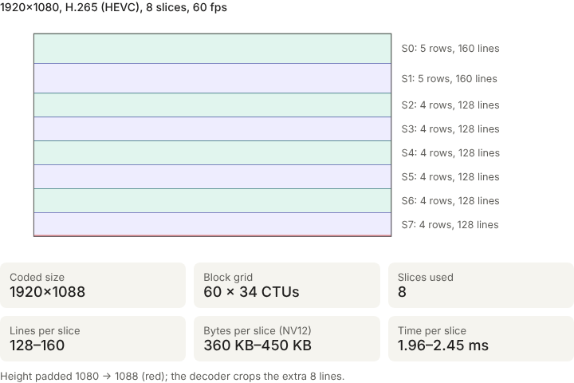 | 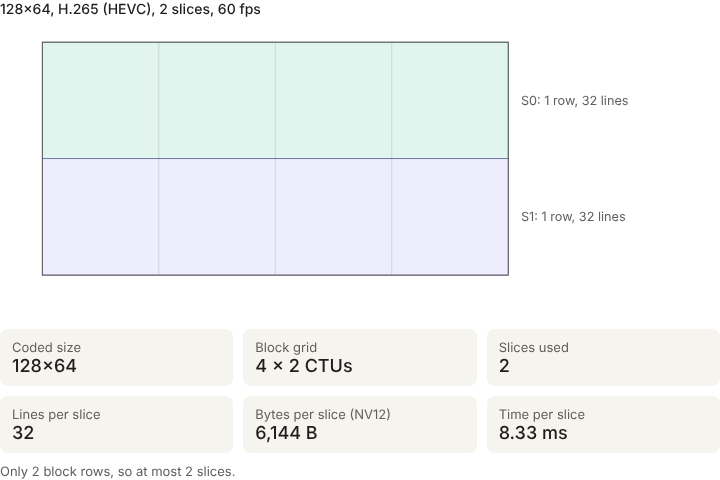 |
| 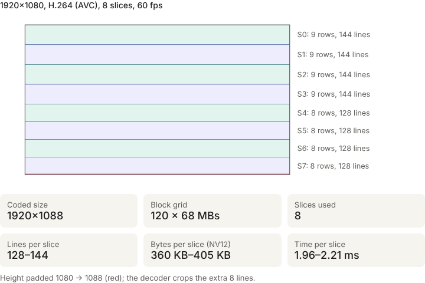 | 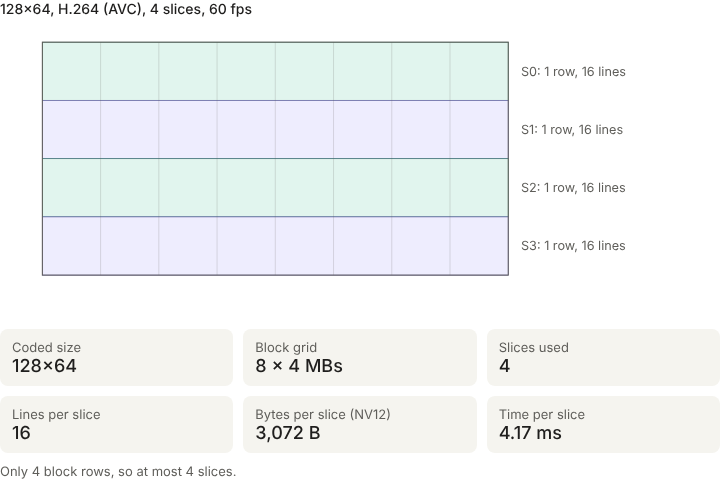 |


> Interactive version: download [`assets/slice_calculator.html`](assets/slice_calculator.html) and open it in a browser. Try 4K as well.

At small resolutions there are only a few rows to share out, so low-latency mode gains little.

**The trade-off of more slices**

| More slices give | More slices cost |
|---|---|
| Lower latency (the encoder starts after a smaller band) | Worse compression: prediction cannot cross slice boundaries |
| Better error resilience: one damaged slice does not ruin the frame | An extra header per slice |

---

### 12. What to check when validating this path

| Area | Typical checks |
|---|---|
| Buffers | Buffer count and size, line pitch and alignment, CMA large enough for the worst case (largest resolution × buffers × streams) |
| Frame-buffer mode | Frame done count matches the frame rate; no buffer is overwritten while the encoder reads it; encoded output decodes to the expected picture (compare against a reference) |
| Low-latency mode | Sync IP programmed with the right luma and chroma start and end addresses; no torn frames over long runs; measured latency close to one slice plus encode time |
| Live out | No overflow or size-mismatch interrupts under the worst downstream load |
| Encoder settings | Every supported codec, resolution, frame rate and slice count, including the smallest and largest; `num-slices` above the row count is limited correctly |
| Performance | DDR bandwidth and AXI QoS with ISP writes, encoder reads and reference-frame traffic all running together |
| Error handling | Stall the producer, starve the encoder of buffers, misprogram an address on purpose: check that the error is reported and the pipeline recovers |
| Latency | Glass-to-glass: from light hitting the sensor to the picture on a screen, for each latency mode |

---

### 13. Summary table

| Step | Where | What happens |
|---|---|---|
| 1 | ISP OBA | Sends NV12 out, either as a live stream (LILO) or towards memory (LIMO) |
| 2 | Frame buffer write IP | Writes the frame into a DDR buffer that came from CMA |
| 3 | Kernel | V4L2 programmed that buffer's address; on frame done the buffer is passed on as a dma-buf |
| 4 | VCU driver and MCU | The address reaches the codec firmware through the mailbox |
| 5 | Sync IP (low latency only) | Holds encoder reads until each slice has been written |
| 6 | VCU | Splits the frame into slices of block rows, then macroblocks or CTUs, predicts, transforms, quantizes and packs bits |

**Key facts**

- Low latency is still a memory mode: DDR plus the Sync IP. LILO has no memory and no Sync IP.
- The Sync IP watches write addresses and holds early reads. It needs no slice interrupt.
- User space never sees DDR addresses: vb2 and CMA allocate them, and dma-buf shares them without copying.
- H.264 and H.265 are standards with an encoder and a decoder each. H.265 needs about half the bitrate.
- Blocks exist so each area can be predicted and only the residual sent. H.264 uses fixed 16×16 blocks; H.265 uses CTUs split by a quadtree.
- A slice is a band of whole block rows. The default is one slice per frame.

#### Glossary

| Term | Meaning |
|---|---|
| VCU | Video codec unit: the hardware video encoder and decoder |
| FB Write IP | Frame buffer write IP: the DMA that writes a video stream into DDR |
| Sync IP | Watches producer writes and holds consumer reads until each slice is written |
| CMA | Contiguous memory allocator: DDR reserved at boot for buffers that DMA engines use |
| vb2 | videobuf2, the kernel's video buffer layer used by V4L2 drivers |
| dma-buf | A kernel handle that lets several drivers share one buffer without copying |
| Mailbox | Shared memory plus interrupts used by Linux and the VCU's MCU to exchange commands |
| AVC / HEVC | H.264 / H.265 |
| Macroblock | H.264's fixed 16×16 block |
| CTU, CU, PU, TU | H.265's coding tree unit and its coding, prediction and transform units |
| DCT | Discrete cosine transform: turns a block of pixels into frequencies |
| QP | Quantization parameter: higher means fewer bits and lower quality |
| RDO | Rate-distortion optimisation: choosing the option with the lowest distortion + λ × bits |
| Slice | A band of whole block rows that is encoded independently |

#### Further reading

- [High Efficiency Video Coding (Wikipedia)](https://en.wikipedia.org/wiki/High_Efficiency_Video_Coding)
- [Advanced Video Coding (Wikipedia)](https://en.wikipedia.org/wiki/Advanced_Video_Coding)
- [videobuf2 and V4L2 buffers (Linux kernel documentation)](https://docs.kernel.org/driver-api/media/v4l2-videobuf2.html)
- [dma-buf buffer sharing (Linux kernel documentation)](https://docs.kernel.org/driver-api/dma-buf.html)

---

## Interview One-liner
*"Frame-buffer mode decouples the ISP and the encoder through DDR and costs at least a frame of delay. Low-latency mode still goes through DDR, but the encoder starts per slice while a Sync IP holds its reads until each band of CTU rows is written. Buffer addresses come from CMA through V4L2 and are shared as dma-bufs, and the encoder splits each frame into macroblocks (H.264) or quadtree CTUs (H.265) so each block can be predicted and only its residual coded."*
