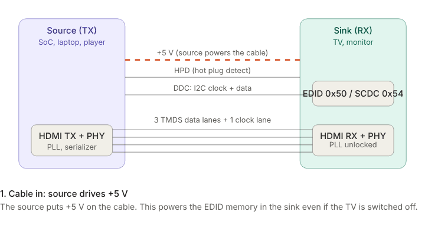
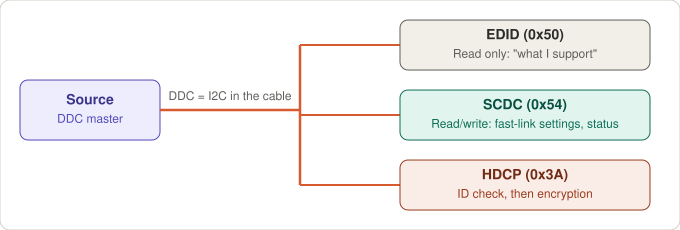
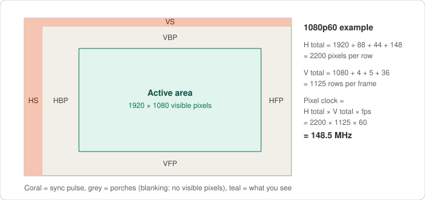
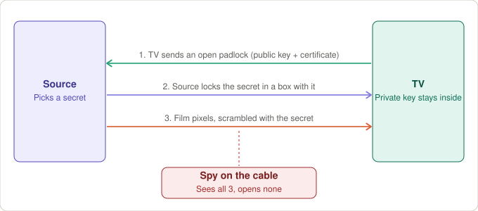
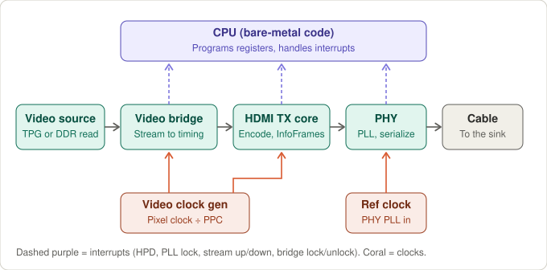
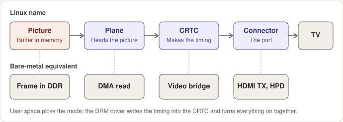
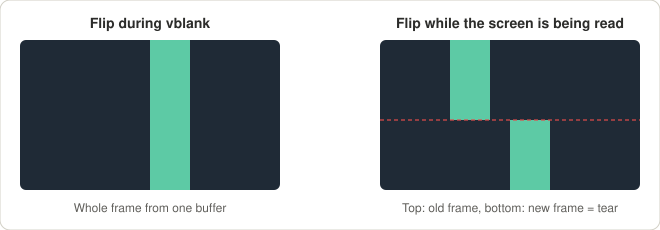
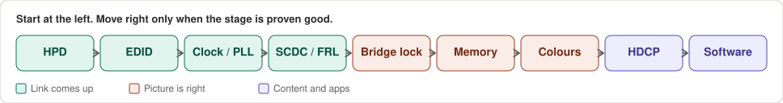
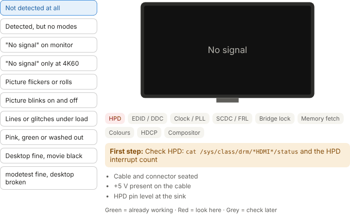

# 03 · HDMI: bring-up and debug, bare metal and Linux

How a picture gets from an SoC to a TV over HDMI, how software brings the link up (first in bare metal, then in Linux), and how to find the broken stage when it does not work.

---

## Theory

### 1. From plugging in the cable to a picture



> Interactive version: download [`assets/hdmi_connect.html`](assets/hdmi_connect.html) and open it in a browser.

| Step | What happens |
|---|---|
| 1 | The **source** (SoC, laptop) puts +5 V on the cable. This powers the EDID memory in the **sink** (TV, monitor) |
| 2 | The sink raises **HPD** (hot plug detect). The source gets an interrupt: a display is connected |
| 3 | The source reads the **EDID** over **DDC** (I2C inside the cable): the list of modes the sink supports |
| 4 | Fast modes only: the source sets up the sink through **SCDC** (scrambling, or FRL link training) |
| 5 | The source programs its clocks, PHY and TX core, and the lanes start sending |
| 6 | The sink's PLL **locks** to the stream and the picture appears |

The source always makes the clock and sets the resolution in its **own** registers. The sink only follows: it detects the resolution from the incoming signal.

---

### 2. The cable and the DDC bus

| Group | Job |
|---|---|
| 3 data lanes | Pixels, audio, InfoFrames |
| 1 clock lane | TMDS clock (becomes a 4th data lane in FRL mode) |
| DDC (SCL, SDA) | I2C bus for EDID, SCDC and HDCP |
| HPD and +5 V | Plug detection and power for the EDID chip |
| CEC | Remote-control commands between devices |

Three things share the one DDC wire, each at its own I2C address:



- **EDID:** a data block in the sink's memory (an EEPROM) listing its supported resolutions, timings and features. Read only.
- **SCDC:** registers in the sink (HDMI 2.0 and newer) that the source writes to switch on fast-link features, and reads for lock status and error counters.
- **HDCP:** the copy-protection handshake (section 5).

---

### 3. Blanking and the pixel clock

Every frame has **blanking**: time when no visible pixels are sent. After each row there is horizontal blanking, and after the last row there is vertical blanking (like the eye jumping back to the start of the next line when reading). HDMI uses this gap to carry audio and InfoFrames.



> **Pixel clock = H total × V total × frames per second**
> H total = pixels in one row, including blanking. V total = rows in one frame, including blanking.

For 1920×1080: 1920 is horizontal (how long each row is), 1080 is vertical (how many rows). The blanking is fixed **per mode** by a standard timing table:

| Mode | H total | V total | Pixel clock |
|---|---|---|---|
| 640×480 @ 60 | 800 (640 + 160) | 525 (480 + 45) | 25.175 MHz |
| 1080p @ 60 | 2200 (1920 + 280) | 1125 (1080 + 45) | **148.5 MHz** |
| 4K @ 60 | 4400 (3840 + 560) | 2250 (2160 + 90) | 594 MHz |

Each TMDS lane runs at **10 × the pixel clock** (every 8-bit value is sent as a 10-bit symbol): 1080p60 needs 1.485 Gbps per lane.

---

### 4. TMDS, FRL and SCDC

| | HDMI 1.4 TMDS | HDMI 2.0 TMDS | HDMI 2.1 FRL |
|---|---|---|---|
| Lanes | 3 data + 1 clock | 3 data + 1 clock | 4 data, clock recovered from the data |
| Per lane | 3.4 Gbps | 6 Gbps | up to 12 Gbps (48 Gbps total) |
| Top mode | about 4K30 | **4K60** | 4K120, 8K60 |
| SCDC needed? | No | Yes, **above 340 MHz**: scrambling on, clock ratio ¼ | Yes: link training |

The rule for SCDC is the clock speed, not "4K": 4K60 (594 MHz) needs it, 4K30 (297 MHz) does not. Without it, the sink shows "no signal" at fast modes even though slower modes work.

---

### 5. HDCP: copy protection

HDCP is only needed for **protected content** (films, streaming). Everything else works without it.

It protects against two things: a recorder **pretending to be a TV**, and someone **tapping the cable**.



1. The sink sends its certificate with a **public key** (an open padlock). The source checks the certificate is genuine and not on the ban list.
2. The source makes a fresh **secret session key**, locks it with that padlock and sends it.
3. Only the sink's **private key**, which never leaves the chip, can unlock it.
4. Pixels and audio are encrypted with the session key, and the link is re-checked regularly.

A tap on the cable sees everything but can open nothing, because the private key never crosses the cable. HDCP 2.2 or newer is needed for 4K content. **Symptom of failure:** the desktop shows, a film shows black or "HDCP error".

---

### 6. Bare-metal bring-up



| Block | Job |
|---|---|
| Video source | A **test pattern generator (TPG)**, or a DMA reading frames from DDR. Sends pixels with no timing |
| Video bridge | Adds the real timing (sync, blanking). **Bridge locked** = timing steady, its FIFO neither empty nor overflowing |
| HDMI TX core | TMDS or FRL encoding, InfoFrames, audio, HDCP, DDC master, HPD input |
| PHY | Its PLL multiplies the reference clock up to the lane rate and serializes the data |

**Two clocks, two jobs**

| Clock | Feeds | Set to |
|---|---|---|
| **Reference clock** | PHY PLL | A steady input, often from a clock chip on the board that software programs over the board's I2C before the PHY starts |
| **Video (pixel) clock** | Bridge and TX core | Pixel clock ÷ pixels per clock (PPC). 4K60 = 594 MHz at 1 PPC or 148.5 MHz at 4 PPC |

The clock frequency comes from the **chosen mode's timing**, not from the EDID. EDID only says which modes the sink accepts. The board I2C (to the clock chip) and DDC (to the sink) are two different buses.

**TX sequence**

1. Reset the cores, register interrupt handlers, set up the reference clock.
2. Wait for **HPD** → connect callback.
3. Read and parse the **EDID** over DDC.
4. Pick a mode and work out the pixel clock and link rate. Above 340 MHz, write SCDC; for FRL, run link training.
5. Program the video clock and PHY PLL; **wait for PLL lock**.
6. Program the TX core: colour format, depth, PPC, timing, AVI InfoFrame, audio.
7. Program the bridge with the **same** timing, then start the video source.
8. **Stream up + bridge locked** → the sink shows the picture. Keep it up for a few seconds with no unlock interrupts.

**RX sequence** (the order is mirrored): the RX holds its own EDID → +5 V from the source triggers the **cable connect** callback → RX raises HPD → RX PHY locks to the incoming clock → RX measures the timing → **stream up** → program the RX video clock and bridge → **bridge lock**. Joining RX to TX (a pass-through) tests both halves end to end.

**Which video source first.** Start with the **TPG**: it takes memory out of the picture, so colour bars prove the clocks, timing, encoding and link. Then switch to reading from DDR; if the picture breaks now, the problem is the buffer address, stride, format or memory bandwidth.

**No EDID? Force a mode.** Skip the EDID step and use a mode every sink accepts: **640×480 @ 60** (mandatory for all HDMI sinks) or **1080p60** (no SCDC needed). Send plain RGB without audio, like DVI.

---

### 7. Linux: kernel mode setting (KMS)

On Linux the kernel's **DRM** framework does the bring-up; its display part is called **KMS**. Only three names matter at first:



| Name | Job | Bare-metal equivalent |
|---|---|---|
| **Plane** | Reads the picture from memory | Frame buffer read DMA |
| **CRTC** | Makes the timing and blends the planes | Video bridge / timing generator |
| **Connector** | The physical port; knows HPD and EDID | HDMI TX port |

**Who configures the CRTC.** User space (a compositor, or `modetest`) picks a mode from the EDID list and sends it to the kernel. The DRM driver writes that mode's timing and pixel clock into the hardware, turning plane, CRTC and connector on together in one **atomic commit**. These are the same steps as the bare-metal sequence, done by the driver.

**vblank** is the vertical blanking gap between two frames. The driver swaps to the next buffer only during vblank, so the whole frame comes from one buffer. Swapping in the middle of a frame shows the top of the old frame and the bottom of the new one: **tearing**.



**modetest** (libdrm's test tool) drives this path with a test-pattern buffer, the Linux version of the TPG test:

```sh
modetest -M <driver> -c                              # list connectors, modes, CRTC IDs
modetest -M <driver> -s <conn>@<crtc>:1920x1080-60   # set the mode, show a test pattern
modetest -M <driver> -s <conn>@<crtc>:1920x1080-60 -v   # flip every vblank, print fps
```

**Where to look**

| Command | Shows |
|---|---|
| `cat /sys/class/drm/card0-HDMI-A-1/status` | connected or disconnected |
| `cat /sys/class/drm/card0-HDMI-A-1/modes` | the mode list built from the EDID |
| `cat /sys/class/drm/card0-HDMI-A-1/edid \| edid-decode` | the raw EDID, decoded |
| `echo 0x1e > /sys/module/drm/parameters/debug` then `dmesg -w` | every DRM step: hotplug, EDID, failed commits |
| `cat /sys/kernel/debug/dri/0/state` | active mode, plane and buffer |
| `cat /sys/kernel/debug/clk/clk_summary` | real clock rates (1080p60 should be 148.5 MHz) |
| `cat /proc/interrupts \| grep -i hdmi` | HPD interrupt count (climbing fast = HPD bouncing) |

**Forcing a mode in Linux:** `video=HDMI-A-1:1920x1080@60D` on the kernel command line (`D` forces the port on), or a firmware EDID with `drm.edid_firmware=HDMI-A-1:edid/1920x1080.bin`.

---

### 8. DisplayPort compared with HDMI

The idea is the same (HPD, EDID, fast lanes, HDCP). The details differ:

| | HDMI | DisplayPort |
|---|---|---|
| Control channel | DDC (I2C) | **AUX channel** in the same cable; EDID is read through it |
| Sink registers | SCDC | **DPCD** |
| Lanes | 3 data + 1 clock (or 4 in FRL) | 1, 2 or 4, clock recovered from the data |
| Link training | Only in HDMI 2.1 FRL | **Always**: clock recovery, then equalization. On failure it retries slower or with fewer lanes |
| Extras | | **MST** (one port, several monitors), **eDP** (laptop panels) |

DisplayPort debug starts the same way: HPD → AUX and EDID → **link training result**. Most DisplayPort failures are training failures.

---

### 9. Debugging: find the first stage that fails



Check one stage, prove it good, then move to the next. Never start in the middle.



> Interactive version: download [`assets/hdmi_debug_scenarios.html`](assets/hdmi_debug_scenarios.html) and open it in a browser. Pick a symptom to see the screen, the failing stage and the first check.

| Symptom | Stage | First check | If that is fine, check next |
|---|---|---|---|
| Not detected at all | HPD | `status` in sysfs, HPD interrupt count | Cable, +5 V, HPD pin level |
| Detected, but no modes | EDID / DDC | Read and decode the `edid` file | Read too soon after HPD (wait ~100 ms), DDC pull-ups, 100 kHz, checksum. Force 1080p60 meanwhile |
| "No signal" on the monitor | Clock / PLL | PHY PLL lock status | Reference clock programmed, right frequency, stable before PHY start |
| "No signal" only at 4K60 | SCDC / FRL | SCDC scrambling and clock ratio written? | SCDC lock bits and error counters, shorter certified cable, FRL training result |
| Picture flickers or rolls | Bridge lock | Count bridge lock/unlock interrupts | Video clock = pixel clock ÷ PPC? Same timing in bridge and TX? Compare `clk_summary` with the mode |
| Picture blinks fully black and back | HPD | Hotplug storm in `dmesg`, status toggling | Loose cable, weak HPD signal |
| Lines or glitches under load | Memory fetch | Underrun counters in debugfs | Same with the TPG? If not, it is memory: bandwidth, QoS, fewer layers |
| Pink, green or washed out | Colours | Output format vs AVI InfoFrame | YCbCr shown as RGB gives pink/green; full vs limited range gives washed out |
| Desktop fine, film black | HDCP | HDCP authentication status | HDCP version (2.2 for 4K), splitters or adapters, keys provisioned |
| `modetest` fine, desktop broken | Software | Compositor logs | The app's buffers, formats and flip timing |

**Flicker: telling the two suspects apart.** A **blink** (fully black, then back) usually means HPD is bouncing: the source tears the link down on every unplug. A picture that stays up but **flickers or rolls** points to the bridge or PLL going in and out of lock. The usual cause is the video clock not matching the mode, or the bridge and TX using different timing. If only 4K60 flickers, check SCDC and the cable; then drop to 1080p with a test pattern to separate link problems from memory or software.

**Linux blank or flickering screen, in order:**
1. Screen goes blank after some minutes and returns on a key press → power saving, not a bug.
2. Check `status` and `modes`, and the HPD interrupt count.
3. Turn on DRM debug and watch `dmesg` for hotplug storms, failed commits, lock timeouts, underruns.
4. Stop the compositor and run `modetest` with a test pattern. Stable → the problem is in user space. Still broken → driver or hardware.
5. Try 1080p60. Fine at 1080p but not 4K60 → SCDC or cable. Broken at 1080p too → clock and timing.
6. Check `clk_summary` and `state` in debugfs, then swap the cable and the monitor.

---

### 10. Key facts

- HPD → EDID over DDC → (SCDC or FRL training for fast modes) → clocks, PHY, TX, bridge → lock → picture.
- Pixel clock = H total × V total × fps; 1080p60 = 2200 × 1125 × 60 = 148.5 MHz.
- The source makes the clock from the chosen mode; EDID only lists what the sink accepts.
- SCDC is needed above 340 MHz (4K60) and for FRL; HDCP only for protected content.
- Linux: plane reads the picture, CRTC makes the timing, connector is the port; buffers are swapped at vblank to avoid tearing.
- Debug from the left: HPD, EDID, clock, fast link, bridge lock, memory, colours, HDCP, software.

#### Glossary

| Term | Meaning |
|---|---|
| Source / sink | The sending device / the receiving display |
| HPD | Hot plug detect: the sink's "I am connected and ready" signal |
| DDC | The I2C bus inside the HDMI cable |
| EDID | The sink's data block listing what it supports |
| SCDC | Sink registers for fast-link settings and status (HDMI 2.0+) |
| TMDS / FRL | HDMI's two link types: 10-bit symbols with a clock lane / packets on 4 lanes with an embedded clock |
| InfoFrame | Metadata in the blanking, such as the AVI InfoFrame (RGB or YCbCr, colour range) |
| HDCP | Copy protection: authenticate the sink, then encrypt |
| PPC | Pixels per clock |
| KMS | Kernel mode setting: the display part of Linux DRM |
| Plane / CRTC / connector | Buffer reader / timing and blending / physical port |
| vblank | The gap between two frames, when buffers are swapped |
| AUX / DPCD | DisplayPort's control channel / sink registers |

---

## Interview One-liner
*"On plug-in the sink raises HPD, the source reads the EDID over DDC and picks a mode, sets SCDC or trains FRL for fast modes, then programs the pixel clock (H total × V total × fps), PHY PLL, TX core and bridge until everything locks. On Linux the DRM driver does the same through the plane, CRTC and connector in one atomic commit, flipping buffers at vblank. When it fails, I check the stages in order (HPD, EDID, PLL, SCDC, bridge lock, memory, colours, HDCP, software) and use a test pattern and 1080p to split link problems from memory and software."*
