# 01 · PCIe (PCI Express)

This topic explains PCIe from the ground up: why it replaced the old PCI bus, how data travels on lanes, how devices are connected, how a packet is built and checked, how reads and writes work, how the receiver avoids overflow, how the link starts up, and how the system discovers every device at boot. Each section answers three questions: what it is, why it is needed, and how it works.

---

## Theory

### 1. Why PCIe was invented

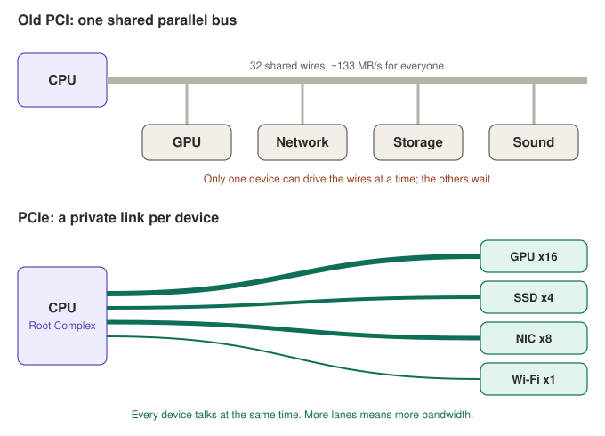

#### The old PCI bus

The older **PCI** bus was a **shared parallel bus**. The CPU and every device (graphics card, network card, storage, sound card) were connected to the **same set of wires**.

- "Parallel" means the **bits** travel side by side: 32 bits on 32 data wires (AD[31:0]) in one clock.
- It does **not** mean the devices each have their own wires. Every card's data pins connect to the same wires (a **multi-drop** bus).
- A wire can carry only one voltage at a time. If two devices drive it together, one pushes a 1 and the other a 0, the signals fight and the data is garbage.
- So only **one device can use the bus at a time**. Each device has just two private wires, `REQ#` (request) and `GNT#` (grant). A device raises `REQ#`, the **arbiter** answers one device with `GNT#`, and everyone else waits.

#### How fast was PCI?

Bandwidth = bus width × clock:

```
32 bits × 33 MHz  =  4 bytes × 33.3 million clocks per second  ≈  133 MB/s
```

That is the best case, and it is **shared by every device on the bus**. In practice it was lower, because time was lost on arbitration and address phases.

#### PCI-X: the last attempt to stretch the parallel bus

**PCI-X** (PCI eXtended, around 1999, mainly for servers) made the same bus wider and faster: 64 bits at up to 133 MHz, about **1066 MB/s**. PCI-X 2.0 sent 2 or 4 transfers per clock (about 2 to 4 GB/s) but was rarely used.

- It was backward compatible: an old PCI card worked in a PCI-X slot, but the bus dropped to the slowest card's speed.
- It was still a shared bus, and the faster the clock, the fewer slots a bus could support (only one slot at 133 MHz).
- **PCI-X is not PCIe.** PCI-X is the old parallel design stretched; PCIe is a new serial design.

#### Why something new was needed

Devices became far hungrier for data:

| Device | Use |
|---|---|
| Graphics card (GPU) | Gaming, AI |
| NVMe SSD | Fast storage |
| 100G network card | Data centres |
| FPGA / accelerator card | Custom compute |

Each needs **gigabytes per second**, while PCI offered about 133 **mega**bytes per second for everyone combined. PCIe solves this by giving **each device its own private link** to the CPU, so all devices can talk at the same time.

| | PCI | PCIe |
|---|---|---|
| Bits | Parallel (32 side by side) | Serial (one after another) |
| Devices | Share the same wires | Each has its own link (point-to-point) |
| Talking | One at a time | All at once |

---

### 2. Lanes, and why serial beats parallel

#### The wall parallel buses hit: skew

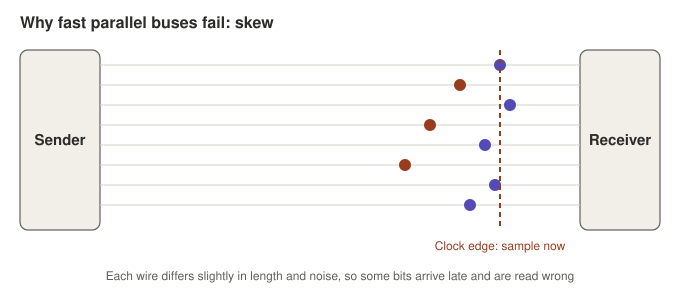

On a parallel bus, all 32 or 64 bits must reach the receiver at the **same clock edge**. Every wire is slightly different in length, load and noise, so the bits arrive at slightly different times. This is called **skew**.

- At low speed, the bit time is long and small differences do not matter.
- At high speed, the bit time becomes tiny, a late bit misses the clock edge, and the receiver reads wrong data.
- A separate clock wire has the same problem: it also drifts against the data wires.

That is why parallel buses could not simply be made faster.

#### What a lane is

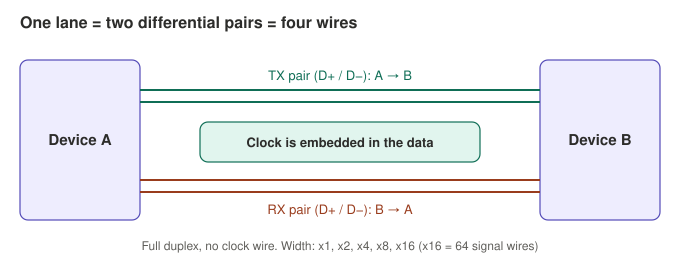

PCIe sends bits **serially**, one after another. The basic unit is a **lane**:

- One lane = **two differential pairs** = **4 wires**.
- One pair **transmits** (TX) and one pair **receives** (RX), so both directions work at once (**full duplex**).
- Each pair is **differential** (D+ and D−). The receiver looks at the difference between the two wires, which cancels noise that hits both.
- There is **no clock wire**. The receiver recovers the timing from the data itself (see [section 4](#why-encoding-is-needed)). With no clock wire to drift, a lane can run at GHz speeds.

#### Link width

A **link** is made of one or more lanes side by side: **x1, x2, x4, x8, x16**.

- Data bytes are **striped** across the lanes: byte 0 on lane 0, byte 1 on lane 1, and so on.
- The receiver lines up each lane on its own (**deskew**) and joins the bytes back together.
- x16 means 16 lanes, which is **64 signal wires**.

#### Two knobs for more bandwidth

```
Bandwidth  =  number of lanes  ×  speed per lane
```

| Knob | Cost |
|---|---|
| **More lanes** (x1 → x4 → x16) | More pins on the chip and connector, more PCB traces to route and length-match, more SerDes blocks on silicon (area and power), more cost |
| **Faster lanes** (new generation) | Same wires, but harder signal integrity: needs equalization, and sometimes retimers on long traces |

Each PCIe generation roughly **doubles the speed per lane**:

| Generation | Per lane, each direction | x16, each direction |
|---|---|---|
| Gen1 (2.5 GT/s, 8b/10b) | 250 MB/s | 4 GB/s |
| Gen3 (8 GT/s, 128b/130b) | ~1 GB/s | ~16 GB/s |
| Gen4 | ~2 GB/s | ~32 GB/s |
| Gen5 | ~4 GB/s | ~64 GB/s |
| Gen6 | ~8 GB/s | ~128 GB/s |

So **x4 Gen5 ≈ x16 Gen3**, using a quarter of the wires.

How real products choose:
- **NVMe SSDs** stay at x4 (small, few pins) and get faster by moving to newer generations.
- **GPUs and AI cards** use x16 and the newest generation, because they need both.
- **Wi-Fi cards** use x1, which is plenty.

#### Where do all these wires physically go?

The wires are real, but you do not see them because they are hidden in two places:

1. **Inside the chip:** the PCIe controller connects to **SerDes PHYs** at the edge of the die.
2. **Package:** the substrate routes these signals down to the **pins or balls under the chip**.
3. **Motherboard:** the traces run on **inner copper layers** of a multi-layer PCB (often 8 to 12 layers), and come out at the slots (x16 slot, M.2 slot).

A typical desktop CPU socket has around **1700 pins**, while 28 PCIe lanes need only 28 × 4 = **112** signal pins. Most pins are power, ground and memory. Large server CPUs have over 6000 pins and 128 lanes, which is where routing gets really complex. Phone chips usually have only x1 or x2.

---

### 3. Topology: Root Complex, Switch, Endpoint

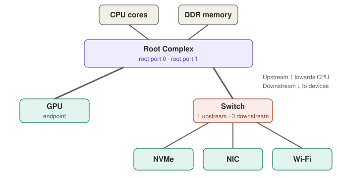

| Part | What it is |
|---|---|
| **Root Complex (RC)** | Lives inside the CPU or SoC. Connects the CPU cores and memory to the PCIe world. Has one or more **root ports**; each starts its own link going down. |
| **Switch** | Fan-out. One **upstream port** (towards the CPU) and several **downstream ports** (towards devices). Forwards packets to the right port. A motherboard chipset behaves like this. |
| **Endpoint (EP)** | The actual device doing the work: GPU, NVMe SSD, network card, Wi-Fi card. |

- **Upstream** = towards the CPU. **Downstream** = towards the devices.
- Every link connects **exactly two ports**, so PCIe is always **point-to-point**.
- Some chips, such as FPGAs, can be configured either as an **endpoint** (plugged into a PC) or as a **root port** (acting as the host).

#### How a switch knows where to send packets

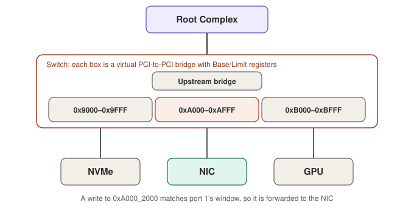

Nobody sets a switch up by hand. Inside, a switch is a set of **virtual PCI-to-PCI bridges**, one per port. Each bridge has registers:

- **Memory Base / Limit**: the address window of all devices below that port.
- **Secondary / Subordinate bus number**: the range of bus numbers below that port.

At boot, the BIOS or OS writes these registers (see [section 8](#8-config-space-and-enumeration)). After that the switch routes by itself: it compares each packet's address with the windows and forwards it to the port whose window contains it.

#### Can a GPU sit behind a switch?

Yes. There is no rule against it. A GPU is usually connected straight to a CPU root port only for **bandwidth**: a switch **shares its one upstream link** among all its devices. For example, an x16 GPU behind a chipset with an x4 uplink would be throttled. Multi-GPU AI servers deliberately place GPUs behind large PCIe switches so the GPUs can talk to each other and to network cards directly (peer-to-peer). External GPUs over Thunderbolt also go through a switch.

---

### 4. Packets (TLPs) and the three layers

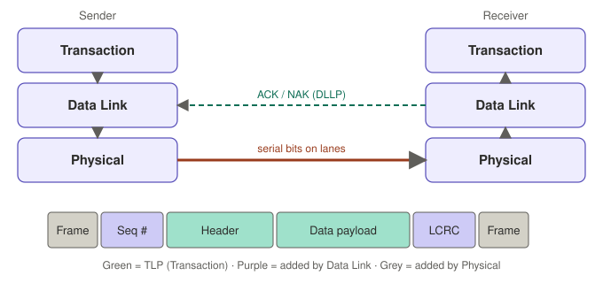

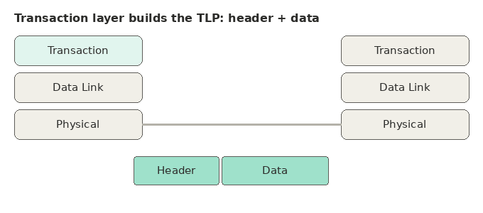

Data moves as packets. Think of a courier parcel: a letter, sealed with a tracking number, carried by a truck. Each layer adds its part on the way out, and the receiver removes them in reverse.

| Layer | Adds | Job |
|---|---|---|
| **Transaction** | **Header** + **data payload** = the **TLP** (Transaction Layer Packet) | Says what to do: memory read or write, config access, completion. The header holds the type, target address, length, requester ID and tag. |
| **Data Link** | **Sequence number** in front, **LCRC** (32-bit CRC) at the end; keeps a copy in a **replay buffer** | Reliable delivery over one link: ACK/NAK and replay |
| **Physical** | Start and end **framing**, **striping** across lanes, **scrambling**, **encoding** | Sends the bits as high-speed differential signals; recovers clock and deskews at the receiver; trains the link at power-up |

#### How the receiver knows a packet arrived correctly

The sender **calculates** a 32-bit CRC over the sequence number and TLP and attaches it as the LCRC. The receiver's Data Link layer runs two checks:

1. **LCRC:** it **recalculates** the CRC over the bits it received and compares with the LCRC it received. Flip even one bit and the result changes completely.
2. **Sequence number:** it checks this is the next packet expected (for example 6 after 5). This catches lost or duplicated packets.

- Both pass → it sends an **ACK** (a small Data Link packet, a **DLLP**), and the sender frees its copy.
- Either fails → it sends a **NAK**, and the sender **replays** the packet from its buffer.

Corner cases:

| Case | What happens |
|---|---|
| The **LCRC itself** is corrupted (data fine) | Recalculated CRC ≠ received LCRC → NAK → replay. A false alarm that costs one resend. Corruption anywhere in the packet is caught the same way. |
| Data and LCRC both corrupted but still matching | Chance about 1 in 4 billion (2³²). An optional **ECRC** gives an extra end-to-end check. |
| The **ACK or NAK** gets corrupted | It is dropped (DLLPs have their own CRC). The sender's **replay timer** expires and it resends; the receiver sees a duplicate sequence number and discards the copy. |

#### Why encoding is needed

**PCIe sends no clock along with the data.** There is a slow **100 MHz reference clock** on the board, but it only tells each side roughly how fast to run. It does not tell the receiver the **exact moment** to sample each bit.

- At Gen5, one bit lasts about **31 picoseconds**. Trace delay, temperature and tiny frequency differences all shift where each bit lands.
- The receiver therefore builds its own sampling clock and keeps it aligned using the **edges in the data** (0→1 and 1→0). This circuit is **CDR (Clock and Data Recovery)**.
- Every edge pulls the sampling point back to the centre of the bit. Between edges, it slowly drifts.

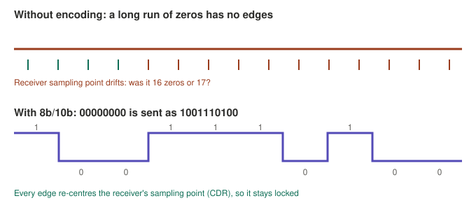

Now imagine sending raw data with a long run of zeros (or ones). On the wire it is just a **flat line**: no edges. The receiver can only measure the duration with its own slightly-off clock, and at billions of bits per second it miscounts: was that 16 zeros or 17?

Compare with other buses:
- **I2C** has a clock line (SCL) that says "data is valid now".
- **UART** has no clock but is slow, and re-synchronises on the start bit of every byte.
- **PCIe** is far too fast to add a start bit to every byte, so instead **encoding guarantees edges keep coming**. Every edge acts like a UART start bit.

Without encoding, three things break:

1. **Clock recovery fails:** no edges, so the receiver drifts and miscounts bits.
2. **DC drift:** PCIe transmit lines have **AC-coupling capacitors**. Long runs of one value charge them up, the signal baseline shifts and bits are misread.
3. **No markers:** without special codes, the receiver cannot tell the start of a packet from ordinary data.

#### How 8b/10b encoding works

8b/10b (used in Gen1 and Gen2) is **not** "put a bit on each side of the byte". It is a **fixed lookup table**, defined in the specification and identical on both sides:

- Each of the 256 possible bytes maps to **one specially chosen 10-bit code**.
- 10 bits give 1024 patterns but only 256 are needed, so only the good ones are used: **at most 5 identical bits in a row**, and a **balanced** count of 1s and 0s.

| Byte | 10-bit code sent | Longest run |
|---|---|---|
| `00000000` | `1001110100` | 3 |
| `00000001` | `0111010100` | 3 |
| `11111111` | `1010110001` | 2 |
| `10110101` | `1010101010` | 1 |
| `1 00000000 1` | **not a valid code, never sent** | 8 |

The receiver uses the reverse table to get the original byte back. If it ever sees a pattern that is not in the table, it knows an **error** happened, which is a bonus error check.

**Finding the boundaries.** The receiver also needs to know where each 10-bit group starts. PCIe sends a special **COMMA** symbol (**K28.5**, `0011111010`), a pattern that can **never appear** in normal data, even across the boundary of two codes. Once the receiver finds a comma, every following 10 bits is one symbol. Commas are re-sent regularly (during training and in SKP ordered sets), so alignment stays locked.

| Encoding | Used in | Overhead | How |
|---|---|---|---|
| 8b/10b | Gen1, Gen2 | 20% | Lookup table, comma for alignment |
| 128b/130b | Gen3 and later | ~1.5% | Scrambling for edges and balance, plus a 2-bit **sync header** (`01` or `10`) marking every 130-bit block |

The drop from 20% to about 1.5% overhead is a big reason Gen3 gained so much efficiency.

> The reference clock gives the approximate speed. The edges in the data give the exact sampling moment. Encoding makes sure those edges always exist.

---

### 5. Reads and writes: posted and non-posted

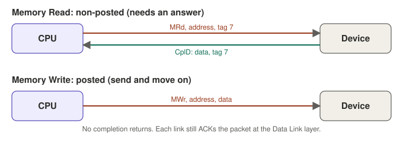

#### Memory read: ask, then wait for the answer

1. The CPU sends a **read request (MRd)** with the address, length and a **tag** (a token number, for example tag 7). It carries no data.
2. It travels through the switch to the device.
3. The device returns a **completion with data (CplD)** marked with the same tag 7.
4. The CPU matches the answer to the question using the **tag and requester ID**. It does not compare the data with anything; the data is simply what the device returned.

Meanwhile the CPU can send more reads with other tags. This is called a **split transaction**. Because a read must always get a reply, it is **non-posted**.

#### Memory write: send and move on

The CPU sends a **write (MWr)** with the address and data, and immediately continues. **No completion ever comes back.** Like posting a letter, it is **posted**.

The CPU does not check that the write landed. Instead:
- **On every link**, the Data Link layer ACKs the packet and replays it if corrupted, so delivery is reliable.
- **If the device has a problem**, it reports an **error message** to the Root Complex on its own (Advanced Error Reporting, AER), which raises an interrupt to the OS.
- **If software needs proof**, it does a **read after the write** (a "flush read"). PCIe ordering rules do not let a read's completion overtake an earlier posted write on the same path, so when the read returns, the earlier write is guaranteed done. Drivers do this, for example, before ringing a device's doorbell register.

Writes are posted for **speed**: the link is already reliable, so waiting for an end-to-end reply on every write would only add delay.

#### TLP types

| TLP | Posted? | Reply |
|---|---|---|
| Memory Write (MWr), including MSI interrupts | Posted | None |
| Message (errors, power management, legacy INTx) | Posted | None |
| Memory Read (MRd) | Non-posted | CplD (with data) |
| Config Read / Write (CfgRd / CfgWr) | Non-posted | CplD / Cpl |
| I/O Read / Write (legacy) | Non-posted | CplD / Cpl |

**Completion status codes:**

| Code | Meaning |
|---|---|
| SC | Successful Completion |
| UR | Unsupported Request |
| CA | Completer Abort |
| CRS | Configuration Request Retry Status: "not ready yet, retry" (common right after reset) |

#### ACK is not a Completion

| | ACK | Completion |
|---|---|---|
| Layer | Data Link | Transaction |
| Scope | One link, hop by hop | End to end, device back to requester |
| Says | "This packet arrived intact" | "Here is the read data / status" |
| Posted writes get it? | Yes | No |

#### Debugging: a value was written but reads back wrong

Example: software writes `0xABCD` to a device register and reads back `0x0000`. That does not automatically mean the data was lost. Go from the cheapest check to the most expensive:

1. **Look at the readback value.** All Fs (`0xFFFFFFFF`) usually means no real reply: Unsupported Request, link down, or no device. All zeros means the device answered, so the read path works.
2. **Check the register specification.** Is it really read/write? It may be read-only, write-only, write-1-to-clear, self-clearing, locked, or inside a block that is still in reset or clock-gated.
3. **Check configuration.** Is **Memory Space Enable** set in the Command register? Is the BAR assigned? Does the address fall inside every switch window on the path?
4. **Read AER status on every port in the path:** Unsupported Request, Malformed TLP, Poisoned TLP, Completer Abort, and the Device Status error bits.
5. **Trace the TLP** with a protocol analyzer, or with an internal logic analyzer on the controller's user interface: did the MWr arrive, with the right address, data and byte enables?

Commonly missed causes:
- **Byte enables:** a 16-bit value written to a 32-bit register with wrong First/Last DW byte enables touches nothing.
- **CPU-side mapping:** if the BAR is mapped as cached or write-combining, the write may still sit in a CPU buffer. Use an uncached mapping and a memory barrier.
- **Internal delay:** PCIe guarantees ordering up to the device, but inside the device the register may update a few cycles later across a clock-domain crossing.

---

### 6. Flow control: credits

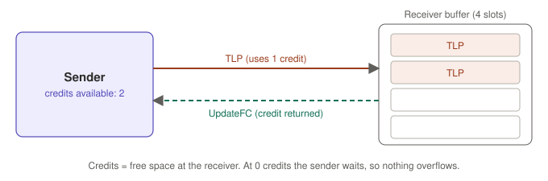

The sender may only send a packet if it **knows the receiver has room** for it. This works like tokens at a car park gate.

1. **At link-up**, the receiver advertises its free buffer space as **credits**, using **InitFC** packets.
2. **Each TLP** the sender sends uses up credits. The sender sends packets; credits are just a permission count.
3. **When credits reach 0**, the sender waits. Nothing overflows and nothing is dropped.
4. **When the receiver frees a slot**, it sends an **UpdateFC** packet and the credits come back.

The sender can have many packets queued, but it can never send more than the receiver advertised.

**Who frees the buffer?** Not the Root Complex. **Every receiving port frees its own buffer** when it is finished with the packet: a switch port frees its slot when it forwards the packet to the next link, and an endpoint frees its slot when it consumes the data. Credits work **per link, in both directions**, and are handled by the **Data Link layer**.

Details:
- Credits are kept separately for **3 traffic types**: **Posted** (writes, messages), **Non-posted** (reads, config), and **Completions**. Each has **Header** and **Data** credits, so there are **6 counters**.
- **1 data credit = 16 bytes** (4 DW). **1 header credit = one TLP header.**
- The types are separate so that a flood of writes cannot block read completions, which helps avoid deadlock.
- If throughput is lower than expected, check whether the sender is **stalling on credits**: the receiver may advertise too few, or return UpdateFC too slowly.

**Order of a link coming up:**

```
Link training (Physical, LTSSM)  →  Flow-control init (Data Link, InitFC)  →  DL_Active  →  TLPs flow
```

---

### 7. Link training: the LTSSM

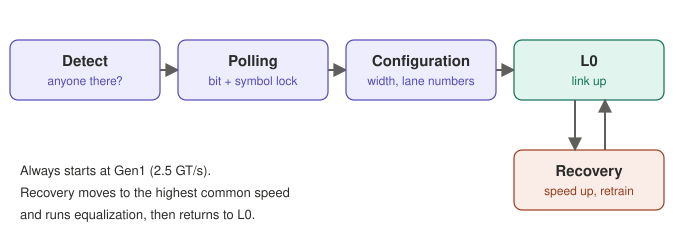

At power-up the two ends know nothing about each other. The **LTSSM (Link Training and Status State Machine)** is a handshake that runs **automatically in hardware**. It is easiest to remember as a phone call:

| State | What happens | Phone call |
|---|---|---|
| **Detect** | Each transmitter electrically checks whether a receiver is present on each lane. Unconnected lanes are dropped. | "Is someone on the line?" |
| **Polling** | Both sides send training sequences **TS1** and **TS2** at Gen1 speed. The receiver achieves **bit lock** (CDR) and **symbol lock** (comma), and fixes swapped D+/D− wires (**polarity inversion**). | "Hello? Can you hear me clearly?" |
| **Configuration** | Agree on **link width** (x16, x8, x4...), number each lane, fix lanes wired in reverse order (**lane reversal**). If some lanes are broken, the link can come up narrower. | "How many lines are we using?" |
| **L0** | Normal working state. Link is up, flow control is initialised, TLPs flow. Still at Gen1 speed. | Talking normally |
| **Recovery** | Change to the highest speed both sides support (for example Gen5) and run **equalization** to tune the signal for this board, then return to L0. Also used to retrain if errors appear later. | "Bad line, let me switch to a better one" |

The link **always starts at Gen1** and uses Recovery to move up.

**L1 is not part of training.** L0s, L1 and L2 are **power-saving** states (like putting a call on hold).

When a link misbehaves:

| Symptom | Likely cause |
|---|---|
| Stuck in Detect or Polling | Board or power issue, missing reference clock, dead lane |
| Comes up slower or narrower than expected (x8 instead of x16, Gen3 instead of Gen5) | Bad lanes, signal integrity or equalization failure |

Check the **Link Status** register (Current Link Speed and Negotiated Link Width), and the controller's LTSSM state debug register if it has one.

---

### 8. Config space and enumeration

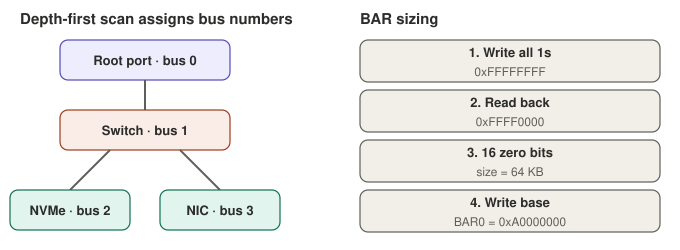

#### Config space: the device's ID card

Every PCIe function has a **4 KB block of registers** called **configuration space**. The first part is a standard header:

| Field | Meaning |
|---|---|
| Vendor ID | Who made the device |
| Device ID | Which product |
| Class code | What kind of device: storage, network, display... |
| Command | On/off switches, including **Memory Space Enable** and **Bus Master Enable** |
| Status | Error and capability flags |
| Header type | **0** = endpoint, **1** = bridge (root port or switch port) |
| BAR0–BAR5 | **Base Address Registers**: how much memory the device needs, and where it is placed |
| Capabilities pointer | Start of a list of extra features: PCIe capability, MSI/MSI-X, power management |

#### Addressing a device: BDF

Config space is reached not by a memory address but by a **BDF**:

| Part | Range | Like |
|---|---|---|
| **B**us | 0–255 | Which road |
| **D**evice | 0–31 | Which house |
| **F**unction | 0–7 | Which room |

For example `01:00.0`, as shown by `lspci` on Linux. Software reads and writes config space with **CfgRd / CfgWr** TLPs (non-posted).

#### Enumeration: the boot-time scan

After the links reach L0, the BIOS (and later the OS) walks the whole tree, **depth first**:

1. At each possible BDF, read the **Vendor ID**. All Fs means nobody is there.
2. If the function is a **bridge** (header type 1: root port or switch port), give the bus below it the **next bus number**, write the Secondary/Subordinate bus numbers into the bridge, and go down.
3. Example: root port on bus 0 → switch on bus 1 → NVMe on bus 2 → back up → NIC on bus 3.

#### BAR sizing: "how much memory do you need?"

1. Write all 1s (`0xFFFFFFFF`) to a BAR.
2. Read it back. The device hardwires its low address bits to 0, so they cannot hold 1s. Reading back `0xFFFF0000` means 16 zero bits.
3. Size = 2¹⁶ = **64 KB**.
4. Write the real base address chosen for the device, for example `0xA0000000`.

Then program each switch's **Memory Base/Limit** windows to cover the devices below each port, and set **Memory Space Enable** and **Bus Master Enable** in the Command register. The device is now live, and the OS loads its driver by matching the Vendor ID and Device ID.

| Symptom | Where to look |
|---|---|
| Device missing from `lspci` | The link probably never came up: check LTSSM |
| Device listed but driver fails | Check BARs and the Command register |

---

## Summary

The whole of PCIe as one courier company:

| # | Concept | In one line |
|---|---|---|
| 1 | Why PCIe | A private road per device instead of one shared road |
| 2 | Lanes | Serial differential pairs with an embedded clock; bandwidth = lanes × speed per lane |
| 3 | Topology | Main gate (Root Complex), junctions (switches), houses (endpoints) |
| 4 | Layers | Letter (TLP) → sealed parcel (sequence number + LCRC) → truck on the highway (framing, encoding) |
| 5 | Read / write | A read is a question and needs an answer; a write is a letter and needs none |
| 6 | Credits | Car park tokens: no space, no entry |
| 7 | LTSSM | A phone call to agree on road size and speed before any truck drives |
| 8 | Enumeration | Read every device's ID card and hand out bus numbers and addresses |

## Glossary

| Term | Meaning |
|---|---|
| AER | Advanced Error Reporting: standard error status registers and error messages |
| BAR | Base Address Register: tells how much memory a device needs and where it is mapped |
| BDF | Bus:Device:Function, the address of a function in config space |
| CDR | Clock and Data Recovery: rebuilds the bit timing from data edges |
| Cpl / CplD | Completion without / with data |
| Credit | Permission to send, equal to free buffer space at the receiver |
| DLLP | Data Link Layer Packet: ACK, NAK, flow-control updates |
| Endpoint | A device at the end of a link (GPU, SSD, NIC) |
| GT/s | Gigatransfers per second, the raw bit rate per lane |
| LCRC | 32-bit CRC added by the Data Link layer to each TLP |
| LTSSM | Link Training and Status State Machine |
| Posted | A request that gets no completion (memory writes, messages) |
| Root Complex | The block in the CPU/SoC that connects CPU and memory to PCIe |
| SerDes | Serializer/deserializer, the high-speed transmit/receive circuit of a lane |
| Skew | Different arrival times of bits on parallel wires |
| TLP | Transaction Layer Packet: header + optional data |

## Further reading

- [PCI-SIG, the organisation that publishes the PCIe specifications](https://pcisig.com/)
- [PCI and PCIe in the Linux kernel documentation](https://docs.kernel.org/PCI/index.html)

---

## Interview One-liner
*"PCIe replaced the shared parallel PCI bus with serial, point-to-point, full-duplex lanes whose clock is embedded in the encoded data. Packets are built by the Transaction layer, made reliable by the Data Link layer with sequence numbers, LCRC and ACK/NAK replay, paced by credits, and sent by the Physical layer after LTSSM link training. At boot, enumeration reads each device's config space, assigns bus numbers and sizes BARs."*
